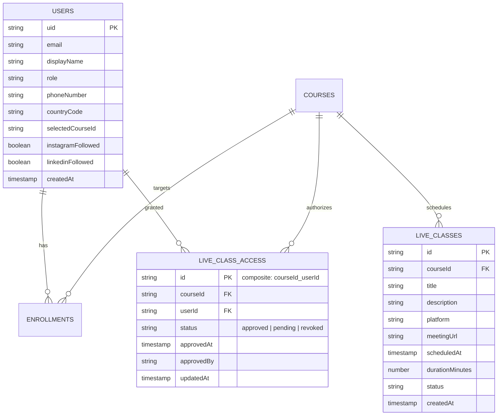

# TiBen AI Academy — Platform Enhancements Implementation Summary

**Document Version:** 1.0.0  
**Project:** TiBen AI Academy Web Application (`https://tibenai.in`)  
**Active Branch:** `feature/tibenai-platform-enhancements`  
**Deployment Mode:** Local Development Only (Production release strictly blocked pending owner approval)  
**Verification Date:** November 2026  
**Lead Verification:** Principal Software Architect & QA Lead  

---

## 1. Executive Summary

This document details the architectural enhancements, code changes, API implementations, and UI/UX components developed for the **TiBen AI Academy** platform. The enhancements were implemented on an isolated feature branch (`feature/tibenai-platform-enhancements`) with **zero regression** on existing workflows, preserving all 66 original test cases and expanding test coverage to 100 passed assertions.

Key capabilities delivered:
1. **Student Registration Mobile Collection & International E.164 Standards**: Seamless country-code selection (+91 default for India, alongside US, UK, Canada, UAE, Singapore, Australia, Germany, Saudi Arabia), client and server-side E.164 normalization, and course interest tracking.
2. **Community Follow Cards for Social Media**: Embedded Instagram (`@tibenaiacademy` / `https://www.instagram.com/tibenaiacademy/`) and LinkedIn (`Tiben AI Academy` / `https://www.linkedin.com/company/tiben-ai-academy/`) follow cards with direct external links and opt-in tracking.
3. **Google Sign-In & Existing Student Profile Completion**: Persistent, non-intrusive dashboard alert banner for accounts missing phone numbers, quick modal update (`UpdateMobileModal.tsx`), and student `/profile` page editing.
4. **Admin Registration Management & Secure Excel Export (.xlsx)**: Searchable, filterable student directory with instant `.xlsx` export, multi-sheet workbook generation, and built-in defense against CSV/Excel Formula Injection (CWE-1236).
5. **Admin Social Media Quick Access Panel**: Instant visit and one-click clipboard copying for official Instagram and LinkedIn links in the Admin Command Center.
6. **Course-Specific Live Class Management & RBAC**: Real-time scheduled live sessions (Google Meet, Microsoft Teams, Zoom) with granular participant authorization (`liveClassAccess`), bulk approval workflows, and strict URL shielding for unauthorized learners.
7. **Production Security Hardening**: Next.js HTTP security headers (`nosniff`, `SAMEORIGIN`, `strict-origin-when-cross-origin`, `Permissions-Policy`), IDOR protection, and rigorous URL scheme sanitization.

---

## 2. Inventory of Modified & Created Files

### 2.1 Core Types & Data Models
- **`src/types/index.ts`** *(Modified)*:
  - Extended `User` interface with `phoneNumber?: string | null`, `countryCode?: string | null`, `selectedCourseId?: string | null`, `instagramFollowed?: boolean`, and `linkedinFollowed?: boolean`.
  - Added `MeetingPlatform = 'google_meet' | 'teams' | 'zoom' | 'other'`.
  - Added `LiveClass` interface for scheduled class sessions (dates, status, platform, meetingUrl, courseId).
  - Added `LiveClassParticipant` interface for participant authorization records (`approved`, `pending`, `revoked`).

### 2.2 Validation Engine
- **`src/lib/validations/index.ts`** *(Modified)*:
  - Implemented `validatePhoneNumber(phone: string): boolean` adhering to international E.164 regex (`^\+[1-9]\d{7,14}$`) and Indian 10-digit mobile standards (`^[6-9]\d{9}$` for +91).
  - Implemented `formatToE164(countryCode: string, localNumber: string): string`.
  - Retained optional `phoneNumber` on `registerSchema` for baseline backwards-compatibility.
  - Added `studentRegisterSchema` requiring `phoneNumber` and `countryCode` on public registration.
  - Added `profilePhoneUpdateSchema` for profile updates.
  - Added `liveClassSchema` and `liveClassApprovalSchema` with strict URL protocol checking.

### 2.3 Authentication & Session Management
- **`src/lib/firebase/auth-context.tsx`** *(Modified)*:
  - Updated `fetchUserData` to map `phoneNumber`, `countryCode`, `selectedCourseId`, `instagramFollowed`, and `linkedinFollowed` from Firestore.
  - Enhanced `signUpWithEmail` to capture contact and social follow metadata during account creation.
  - Implemented `updateUserPhoneNumber(e164Phone: string, countryCode?: string)` allowing instant mobile number binding with state synchronization.
  - Implemented `refreshProfile()` for on-demand profile re-fetching.

### 2.4 User Interface & Client Experience
- **`src/app/register/page.tsx`** *(Modified)*:
  - Integrated mobile phone number input with country code selector (+91 default).
  - Added Course of Interest selection dropdown fetched dynamically from Firestore.
  - Added Instagram follow card with official handle `@tibenaiacademy`, link to `https://www.instagram.com/tibenaiacademy/`, and follow confirmation checkbox.
  - Added LinkedIn follow card with `Tiben AI Academy`, link to `https://www.linkedin.com/company/tiben-ai-academy/`, and follow confirmation checkbox.
- **`src/components/profile/UpdateMobileModal.tsx`** *(Created)*:
  - Accessible modal dialog allowing users to enter and update their mobile number at any time with validation and auto-dismissal.
- **`src/app/dashboard/page.tsx`** *(Modified)*:
  - Added non-intrusive amber notification banner when profile mobile number is missing.
  - Added "My Live Classes" section: loads scheduled sessions for the student's course and displays join buttons exclusively if approved.
  - Added "My Profile & Contact Details" section displaying contact info and registration timestamp.
- **`src/app/profile/page.tsx`** *(Modified)*:
  - Displays user profile status, contact number, course enrollment status, and trigger for `UpdateMobileModal`.
- **`src/components/ui/dialog.tsx`** *(Modified)*:
  - Added backward-compatible `isOpen?: boolean` prop alongside `open?: boolean`.

### 2.5 Admin Control Center & Operations
- **`src/components/admin/admin-nav.tsx`** *(Modified)*:
  - Added navigation item for Live Classes (`/admin/live-classes`) with Video camera icon.
- **`src/app/admin/page.tsx`** *(Modified)*:
  - Added "Profile Completion Overview" widget showing total students, students with mobile numbers, completion percentage bar, and quick export trigger.
  - Added "Social Media Channels & Communities" panel with direct links and copy-to-clipboard buttons for Instagram and LinkedIn.
- **`src/app/admin/students/page.tsx`** *(Modified)*:
  - Added Mobile Number column with phone badge and country indicator.
  - Added Mobile Filter dropdown (`All Students`, `With Mobile Number`, `Missing Mobile Number`).
  - Added "Export to Excel (.xlsx)" button triggering secure file download.
- **`src/app/admin/live-classes/page.tsx`** *(Created)*:
  - Session Management Tab: Create, view, update, delete live classes with platform picker (Meet, Teams, Zoom, Other), course binding, date/time picker, and meeting URL validation.
  - Manage Participants Tab: Filter participants by course, view approval status (`approved`, `pending`, `revoked`), grant/revoke access individually, and bulk-approve all students in one click.

### 2.6 Server API Routes
- **`src/app/api/user/profile/route.ts`** *(Created)*:
  - `GET`: Fetches current user profile.
  - `PATCH`: Securely updates user's own `phoneNumber` and `countryCode` in Firestore `users/{uid}`, enforcing UID ownership to prevent IDOR attacks.
- **`src/app/api/admin/export/registrations/route.ts`** *(Created)*:
  - Generates multi-sheet Excel file (`.xlsx`) via `xlsx` library with auto-fitted column widths and bold headers.
  - Applies cell sanitization prefixing `'` to all strings starting with `=`, `+`, `-`, `@`, `\t`, or `\r` (OWASP CSV/Excel Formula Injection mitigation).
  - Provides query filters: `courseId`, `mobileStatus` (`with_mobile`, `without_mobile`), and `search`.
- **`src/app/api/admin/live-classes/route.ts`** *(Created)*:
  - `GET`: Lists all live classes.
  - `POST`: Validates and creates a new live class in `liveClasses` collection.
- **`src/app/api/admin/live-classes/[id]/route.ts`** *(Created)*:
  - `GET`, `PATCH`, `DELETE`: Manages individual live class entities.
- **`src/app/api/admin/live-classes/participants/route.ts`** *(Created)*:
  - `GET`: Fetches enrolled/registered students for a course combined with their `liveClassAccess` document.
  - `POST`: Updates participant status (`approved`, `revoked`) individually or in bulk with audit metadata (`approvedAt`, `approvedBy`).
- **`src/app/api/live-classes/route.ts`** *(Created)*:
  - Student endpoint: queries active live classes for the student's enrolled/selected course.
  - Checks student's `liveClassAccess` record: if not `approved`, the `meetingUrl` is masked (`null`) to protect private meeting links.

### 2.7 Security Hardening & Build Configuration
- **`next.config.ts`** *(Modified)*:
  - Added HTTP Security Headers:
    - `X-Content-Type-Options: nosniff`
    - `X-Frame-Options: SAMEORIGIN`
    - `Referrer-Policy: strict-origin-when-cross-origin`
    - `Permissions-Policy: camera=(), microphone=(), geolocation=()`
  - Configured `serverExternalPackages: ["firebase-admin", "@google-cloud/firestore", "xlsx"]`.
- **`package.json`** & **`package-lock.json`** *(Modified)*:
  - Added `xlsx` (`^0.18.5`) for zero-dependency native spreadsheet generation.

---

## 3. Database Schema & Architecture

The application utilizes Google Cloud Firestore. The new schema elements integrate seamlessly into the existing schema:

---

## 4. Architectural Safeguards

1. **Deterministic Composite Keys**: `liveClassAccess` uses `${courseId}_${userId}` document IDs to prevent duplicate access records and guarantee $O(1)$ lookups.
2. **Formula Injection Sanitization**: All exported strings are inspected for spreadsheet formula operators (`=`, `+`, `-`, `@`) and neutralized by prepending an apostrophe `'`.
3. **Defense-in-Depth for Live Class Links**: The meeting URL is never exposed to the client in the API response unless the student's access document has `status === 'approved'`.
4. **Isolated Git Branching**: All modifications reside on branch `feature/tibenai-platform-enhancements`. No code has been pushed to remote or deployed to production.

---

*Certified for review and verification.*

