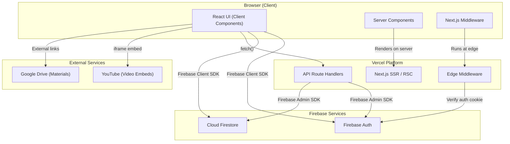
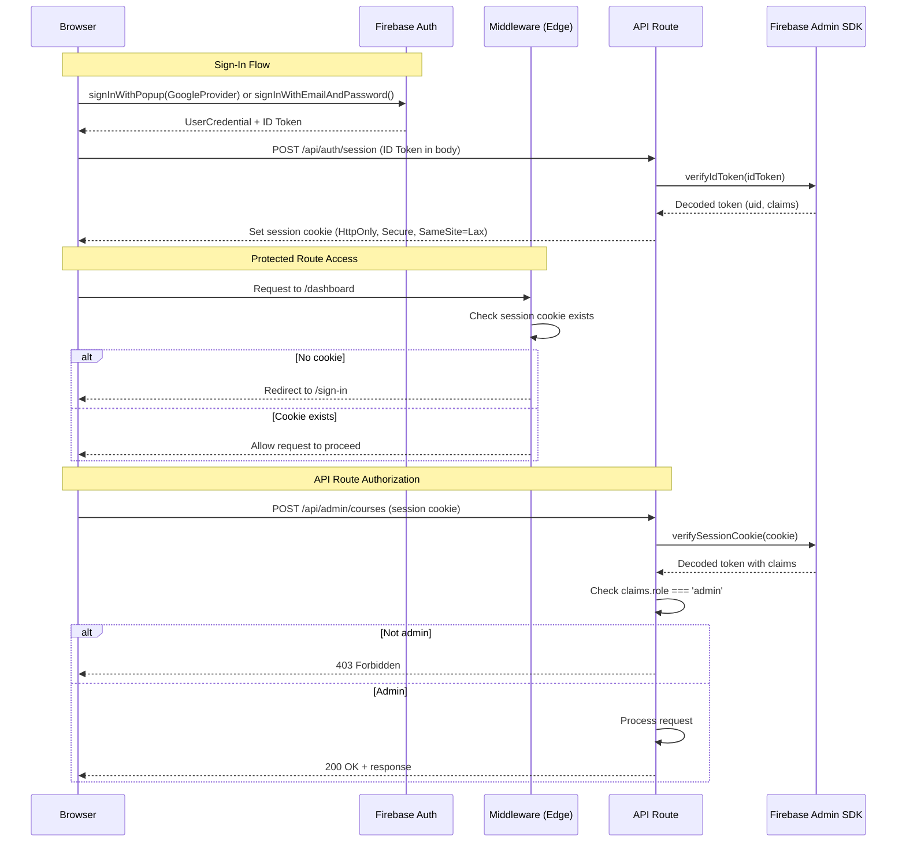
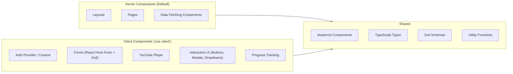

# Architecture — Data Horizon Academy

> **Version:** 1.0  
> **Last Updated:** 2026-10-23  
> **Status:** Approved

---

## 1. Architecture Overview

Data Horizon Academy is a **Next.js 14+ App Router** application deployed on **Vercel**, using **Firebase** for authentication and data storage. The architecture follows a clear separation between public pages, student-facing pages, and admin pages through Next.js route groups.



### Key Architectural Decisions

| Decision | Rationale |
|----------|-----------|
| **Next.js App Router** | Server Components for performance, Route Handlers for API, built-in middleware |
| **Firebase Client SDK on client** | Direct Firestore reads from browser, Firebase Auth state management |
| **Firebase Admin SDK in API routes only** | Privileged operations (enrollment, admin CRUD, role checks) run server-side |
| **No Cloud Functions** | Firebase Spark plan doesn't include Cloud Functions; Vercel API routes serve the same purpose |
| **YouTube embeds** | Zero video hosting cost; videos served directly from YouTube CDN |
| **Google Drive links** | Zero file hosting cost; materials served directly from Google Drive |

---

## 2. Application Structure

### 2.1 Route Groups

The Next.js App Router uses **route groups** to organize the application into three distinct sections, each with its own layout:

```
app/
├── (public)/              # Public-facing pages (no auth required)
│   ├── layout.tsx         # Public layout (minimal header)
│   ├── page.tsx           # Landing page (/)
│   ├── sign-in/
│   │   └── page.tsx       # Sign-in page
│   └── sign-up/
│       └── page.tsx       # Sign-up page
│
├── (student)/             # Student-facing pages (auth required)
│   ├── layout.tsx         # Student layout (sidebar, nav)
│   ├── dashboard/
│   │   └── page.tsx       # Student dashboard
│   ├── courses/
│   │   └── [slug]/
│   │       ├── page.tsx   # Course overview
│   │       └── lessons/
│   │           └── [lessonId]/
│   │               └── page.tsx  # Lesson viewer
│   └── enroll/
│       └── page.tsx       # Enrollment code redemption
│
├── (admin)/               # Admin pages (admin role required)
│   ├── layout.tsx         # Admin layout (admin sidebar)
│   └── admin/
│       ├── page.tsx       # Admin dashboard
│       ├── courses/
│       │   ├── page.tsx           # Course list
│       │   ├── new/
│       │   │   └── page.tsx       # Create course
│       │   └── [courseId]/
│       │       ├── page.tsx       # Edit course
│       │       ├── weeks/
│       │       ├── modules/
│       │       ├── lessons/
│       │       └── resources/
│       ├── enrollment-codes/
│       │   └── page.tsx           # Manage enrollment codes
│       └── users/
│           └── page.tsx           # User management
│
├── api/                   # API Route Handlers
│   ├── auth/
│   │   ├── session/
│   │   │   └── route.ts   # Session cookie management
│   │   └── verify/
│   │       └── route.ts   # Token verification
│   ├── admin/
│   │   ├── courses/
│   │   │   └── route.ts   # Course CRUD
│   │   ├── weeks/
│   │   │   └── route.ts   # Week CRUD
│   │   ├── modules/
│   │   │   └── route.ts   # Module CRUD
│   │   ├── lessons/
│   │   │   └── route.ts   # Lesson CRUD
│   │   ├── resources/
│   │   │   └── route.ts   # Resource CRUD
│   │   ├── enrollment-codes/
│   │   │   └── route.ts   # Code generation/revocation
│   │   └── users/
│   │       └── route.ts   # User management
│   ├── enrollment/
│   │   └── redeem/
│   │       └── route.ts   # Code redemption
│   └── progress/
│       └── route.ts       # Lesson progress updates
│
├── layout.tsx             # Root layout
├── loading.tsx            # Global loading state
├── not-found.tsx          # 404 page
└── error.tsx              # Error boundary
```

### 2.2 Route Group Responsibilities

| Route Group | Auth Required | Role Required | Purpose |
|-------------|---------------|---------------|---------|
| `(public)` | No | None | Landing page, sign-in, sign-up |
| `(student)` | Yes | Any authenticated user | Student dashboard, course viewer, enrollment |
| `(admin)` | Yes | `admin` custom claim | Content management, user management |

---

## 3. Authentication Architecture

### 3.1 Auth Flow



### 3.2 Auth Components

| Component | Location | Purpose |
|-----------|----------|---------|
| **Firebase Client SDK** | Client Components | `signInWithPopup`, `signInWithEmailAndPassword`, `onAuthStateChanged` |
| **AuthContext / AuthProvider** | Client Component (wraps app) | Provides current user state to all components |
| **Session Cookie** | HttpOnly cookie | Server-side auth verification without exposing tokens |
| **Middleware** | `middleware.ts` | Route protection at the edge; checks cookie presence |
| **API Route Auth** | Route Handlers | Verifies session cookie via Firebase Admin SDK; checks custom claims |

### 3.3 Session Management

```
1. User signs in via Firebase Auth (client-side)
2. Client sends ID token to POST /api/auth/session
3. Server verifies token with Firebase Admin SDK
4. Server creates a session cookie (5 days expiry) via verifyIdToken + createSessionCookie
5. Cookie is set as HttpOnly, Secure, SameSite=Lax
6. Subsequent requests include the cookie automatically
7. API routes verify the session cookie server-side
8. On sign-out, client calls POST /api/auth/session (DELETE) to clear the cookie
```

### 3.4 Admin Role Verification

Admin status is determined by Firebase Auth **custom claims**:

```typescript
// Custom claim structure
interface CustomClaims {
  role: 'admin' | 'student';
}

// Verification in API routes
const decodedToken = await adminAuth.verifySessionCookie(sessionCookie);
if (decodedToken.role !== 'admin') {
  return NextResponse.json({ error: 'Forbidden' }, { status: 403 });
}
```

---

## 4. Data Access Patterns

### 4.1 Client-Side Reads (Firebase Client SDK)

The Firebase Client SDK is used for **read operations** where Firestore Security Rules provide sufficient access control:

| Operation | Who | Security |
|-----------|-----|----------|
| Read enrolled courses | Student | Security rules verify enrollment |
| Read published content (weeks, modules, lessons) | Student | Security rules verify enrollment + published status |
| Read lesson progress | Student | Security rules verify userId matches |
| Read course list | Admin | Security rules verify admin claim |

### 4.2 Server-Side Operations (API Routes + Firebase Admin SDK)

Vercel API Route Handlers with the Firebase Admin SDK are used for **privileged operations**:

| Operation | Endpoint | Why Server-Side |
|-----------|----------|-----------------|
| Enrollment code redemption | `POST /api/enrollment/redeem` | Atomic transaction, hash verification |
| Course CRUD | `POST/PUT/DELETE /api/admin/courses` | Admin-only write operations |
| Content CRUD | Various `/api/admin/*` routes | Admin-only write operations |
| Code generation | `POST /api/admin/enrollment-codes` | Secure code hashing, admin verification |
| Code revocation | `PATCH /api/admin/enrollment-codes` | Admin-only status change |
| User management | Various `/api/admin/users` routes | Admin-only operations |
| Session management | `POST/DELETE /api/auth/session` | HttpOnly cookie creation/deletion |
| Progress updates | `POST /api/progress` | Server-side validation of enrollment |

### 4.3 Why This Split?

| Concern | Client SDK | Admin SDK (API Routes) |
|---------|------------|----------------------|
| **Auth** | Client-side state management | Server-side token/session verification |
| **Reads** | Direct reads with security rules | Admin reads bypassing rules |
| **Writes** | Not used for writes | All writes go through API routes |
| **Security Rules** | Enforced automatically | Bypassed (admin SDK has full access) |
| **Transactions** | Limited | Full transaction support |

> **Design Principle:** All write operations go through API Route Handlers. The client SDK is used only for authenticated reads where Firestore Security Rules provide adequate protection.

---

## 5. Middleware Architecture

```typescript
// middleware.ts — runs at the Vercel Edge

import { NextRequest, NextResponse } from 'next/server';

const PUBLIC_PATHS = ['/', '/sign-in', '/sign-up'];
const ADMIN_PATH_PREFIX = '/admin';

export function middleware(request: NextRequest) {
  const { pathname } = request.nextUrl;
  const sessionCookie = request.cookies.get('session');

  // Allow public paths
  if (PUBLIC_PATHS.some(p => pathname === p || pathname.startsWith(p + '/'))) {
    return NextResponse.next();
  }

  // Require authentication for all other paths
  if (!sessionCookie) {
    return NextResponse.redirect(new URL('/sign-in', request.url));
  }

  // Note: Admin role verification happens in API routes and page components,
  // not in middleware (middleware cannot verify Firebase tokens without
  // the Admin SDK, which doesn't run at the edge).

  return NextResponse.next();
}

export const config = {
  matcher: ['/((?!_next/static|_next/image|favicon.ico|api/).*)'],
};
```

### Middleware Limitations

- **Edge Runtime** cannot use the Firebase Admin SDK (Node.js-only dependency).
- Middleware checks **cookie presence** only; it does not verify the cookie's validity or claims.
- **Full authorization** (token verification + role checking) is performed in API routes and Server Components.

---

## 6. Component Architecture

### 6.1 Component Types



### 6.2 Server Components (Default)

Used for static or data-fetching portions of the UI:

- **Layouts** — Root, public, student, and admin layouts
- **Page shells** — Structural page components that pass data to client components
- **Static content** — Headers, footers, navigation structure

### 6.3 Client Components (`'use client'`)

Used when interactivity or browser APIs are required:

- **AuthProvider** — Wraps the app; manages Firebase Auth state with `onAuthStateChanged`
- **Forms** — All forms use React Hook Form + Zod and require client-side JavaScript
- **YouTube Embed** — iframe embed component
- **Interactive UI** — Buttons, modals, dropdowns, toggles, toasts (shadcn/ui)
- **Progress Tracking** — "Mark as Complete" button and progress bars
- **Data Lists with Client Queries** — Components that read from Firestore using the client SDK

### 6.4 Shared Modules

```
lib/
├── firebase/
│   ├── client.ts          # Firebase Client SDK initialization
│   ├── admin.ts           # Firebase Admin SDK initialization (server-only)
│   ├── auth.ts            # Auth helper functions
│   └── firestore.ts       # Firestore helper functions
├── schemas/
│   ├── course.ts          # Course Zod schemas
│   ├── lesson.ts          # Lesson Zod schemas
│   ├── enrollment.ts      # Enrollment Zod schemas
│   └── ...
├── types/
│   ├── course.ts          # Course TypeScript interfaces
│   ├── user.ts            # User TypeScript interfaces
│   └── ...
├── utils/
│   ├── youtube.ts         # YouTube URL parsing
│   ├── slug.ts            # Slug generation
│   └── ...
└── hooks/
    ├── useAuth.ts         # Auth context hook
    ├── useCourses.ts      # Course data hooks
    └── ...

components/
├── ui/                    # shadcn/ui components
│   ├── button.tsx
│   ├── card.tsx
│   ├── dialog.tsx
│   └── ...
├── auth/
│   ├── auth-provider.tsx
│   ├── sign-in-form.tsx
│   └── sign-up-form.tsx
├── admin/
│   ├── course-form.tsx
│   ├── lesson-form.tsx
│   └── ...
├── student/
│   ├── course-card.tsx
│   ├── lesson-viewer.tsx
│   └── ...
└── shared/
    ├── header.tsx
    ├── sidebar.tsx
    └── ...
```

---

## 7. API Route Handler Pattern

All API routes follow a consistent pattern:

```typescript
// app/api/admin/courses/route.ts

import { NextRequest, NextResponse } from 'next/server';
import { adminAuth, adminDb } from '@/lib/firebase/admin';
import { courseSchema } from '@/lib/schemas/course';

export async function POST(request: NextRequest) {
  try {
    // 1. Verify authentication
    const sessionCookie = request.cookies.get('session')?.value;
    if (!sessionCookie) {
      return NextResponse.json({ error: 'Unauthorized' }, { status: 401 });
    }

    // 2. Verify session and check claims
    const decodedToken = await adminAuth.verifySessionCookie(sessionCookie, true);
    if (decodedToken.role !== 'admin') {
      return NextResponse.json({ error: 'Forbidden' }, { status: 403 });
    }

    // 3. Validate CSRF (check Origin header)
    const origin = request.headers.get('origin');
    if (origin !== process.env.NEXT_PUBLIC_APP_URL) {
      return NextResponse.json({ error: 'Forbidden' }, { status: 403 });
    }

    // 4. Parse and validate request body with Zod
    const body = await request.json();
    const validatedData = courseSchema.parse(body);

    // 5. Perform the operation
    const docRef = await adminDb.collection('courses').add({
      ...validatedData,
      createdAt: new Date(),
      updatedAt: new Date(),
    });

    // 6. Return response
    return NextResponse.json({ id: docRef.id }, { status: 201 });

  } catch (error) {
    if (error instanceof z.ZodError) {
      return NextResponse.json({ error: error.errors }, { status: 400 });
    }
    console.error('Error creating course:', error);
    return NextResponse.json({ error: 'Internal Server Error' }, { status: 500 });
  }
}
```

---

## 8. External Service Integration

### 8.1 YouTube Video Embedding

```typescript
// YouTube URL parsing utility
function extractYouTubeVideoId(url: string): string | null {
  const patterns = [
    /(?:youtube\.com\/watch\?v=)([a-zA-Z0-9_-]{11})/,
    /(?:youtu\.be\/)([a-zA-Z0-9_-]{11})/,
    /(?:youtube\.com\/embed\/)([a-zA-Z0-9_-]{11})/,
  ];
  for (const pattern of patterns) {
    const match = url.match(pattern);
    if (match) return match[1];
  }
  return null;
}

// Embed component renders:
// <iframe src={`https://www.youtube.com/embed/${videoId}`} ... />
```

### 8.2 Google Drive Resource Links

Resources are stored as direct Google Drive URLs. The UI renders them as external links that open in a new tab. No API integration with Google Drive is required.

---

## 9. Build and Bundle Architecture

```
Next.js Build Output
├── Static Pages (ISR-compatible)
│   └── Landing page, sign-in, sign-up
├── Dynamic Pages (SSR)
│   └── Dashboard, course pages (require auth state)
├── API Routes (Serverless Functions)
│   └── All /api/* routes deploy as Vercel Serverless Functions
├── Edge Middleware
│   └── middleware.ts deploys to Vercel Edge Network
└── Static Assets
    └── CSS, JS bundles, images via _next/static
```

### Build Optimization

| Strategy | Details |
|----------|---------|
| **Tree Shaking** | Firebase Admin SDK imported only in API routes (not bundled in client) |
| **Dynamic Imports** | Heavy components (e.g., rich text editors if added) loaded dynamically |
| **Image Optimization** | Course cover images served through Next.js Image component with external domains |
| **Font Optimization** | `next/font` for optimized font loading |
| **Bundle Analysis** | Monitor client bundle to ensure Firebase Admin SDK doesn't leak into client code |

---

## 10. Error Handling Strategy

| Layer | Strategy |
|-------|----------|
| **Client Components** | Try/catch with toast notifications (shadcn/ui Sonner) |
| **Server Components** | `error.tsx` error boundaries per route segment |
| **API Routes** | Structured JSON error responses with appropriate HTTP status codes |
| **Form Validation** | Inline field errors via React Hook Form + Zod |
| **Not Found** | `not-found.tsx` for 404 pages |
| **Global** | Root `error.tsx` as a catch-all error boundary |

---

## 11. Environment Configuration

```bash
# .env.local

# Firebase Client SDK (public — exposed to browser)
NEXT_PUBLIC_FIREBASE_API_KEY=
NEXT_PUBLIC_FIREBASE_AUTH_DOMAIN=
NEXT_PUBLIC_FIREBASE_PROJECT_ID=
NEXT_PUBLIC_FIREBASE_STORAGE_BUCKET=
NEXT_PUBLIC_FIREBASE_MESSAGING_SENDER_ID=
NEXT_PUBLIC_FIREBASE_APP_ID=

# Firebase Admin SDK (server-only — never exposed to browser)
FIREBASE_ADMIN_PROJECT_ID=
FIREBASE_ADMIN_CLIENT_EMAIL=
FIREBASE_ADMIN_PRIVATE_KEY=

# Application
NEXT_PUBLIC_APP_URL=https://your-domain.vercel.app
```

> **Security Note:** Variables prefixed with `NEXT_PUBLIC_` are embedded in client bundles and visible in the browser. Firebase Admin SDK credentials must **never** use this prefix.
