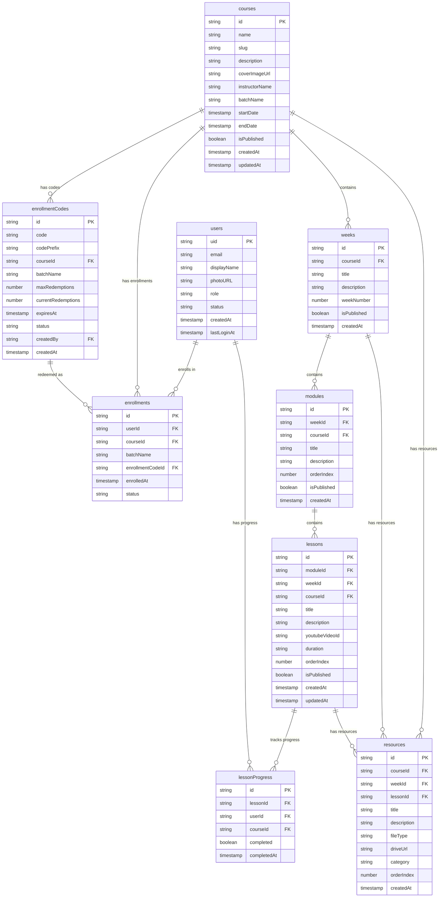

# Data Model — Data Horizon Academy

> **Version:** 1.0  
> **Last Updated:** 2026-10-23  
> **Status:** Approved  
> **Database:** Cloud Firestore

---

## 1. Overview

Data Horizon Academy uses Cloud Firestore as its primary database. All collections are **top-level** (no sub-collections) to simplify querying and security rules. Documents reference each other via ID fields.

### Entity Relationship Diagram



---

## 2. Collection Schemas

### 2.1 `users`

Stores user profile information. The document ID matches the Firebase Auth UID.

| Field | Type | Required | Description |
|-------|------|----------|-------------|
| `uid` | `string` | Yes | Firebase Auth UID (same as document ID) |
| `email` | `string` | Yes | User's email address |
| `displayName` | `string` | Yes | User's display name |
| `photoURL` | `string` | No | Profile photo URL (from Google, or `null`) |
| `role` | `string` | Yes | `'student'` or `'admin'` |
| `status` | `string` | Yes | `'active'` or `'suspended'` |
| `createdAt` | `Timestamp` | Yes | Account creation timestamp |
| `lastLoginAt` | `Timestamp` | Yes | Last sign-in timestamp |

**Document ID:** Firebase Auth `uid`

```typescript
interface User {
  uid: string;
  email: string;
  displayName: string;
  photoURL: string | null;
  role: 'student' | 'admin';
  status: 'active' | 'suspended';
  createdAt: Timestamp;
  lastLoginAt: Timestamp;
}
```

**Notes:**
- Created on first sign-in (client checks if doc exists, creates if not)
- The `role` field in Firestore mirrors the custom claim but is useful for admin queries
- The `role` custom claim on the Firebase Auth token is the source of truth for authorization
- `status: 'suspended'` prevents the user from accessing content

---

### 2.2 `courses`

Stores course metadata.

| Field | Type | Required | Description |
|-------|------|----------|-------------|
| `id` | `string` | Yes | Auto-generated document ID |
| `name` | `string` | Yes | Course title |
| `slug` | `string` | Yes | URL-friendly slug (unique) |
| `description` | `string` | Yes | Course description (plain text or markdown) |
| `coverImageUrl` | `string` | No | External URL for the cover image |
| `instructorName` | `string` | Yes | Name of the instructor |
| `batchName` | `string` | Yes | Batch identifier (e.g., "Batch 2024-Q4") |
| `startDate` | `Timestamp` | No | Course start date |
| `endDate` | `Timestamp` | No | Course end date |
| `isPublished` | `boolean` | Yes | Whether the course is visible to enrolled students |
| `createdAt` | `Timestamp` | Yes | Creation timestamp |
| `updatedAt` | `Timestamp` | Yes | Last update timestamp |

**Document ID:** Auto-generated by Firestore

```typescript
interface Course {
  id: string;
  name: string;
  slug: string;
  description: string;
  coverImageUrl: string | null;
  instructorName: string;
  batchName: string;
  startDate: Timestamp | null;
  endDate: Timestamp | null;
  isPublished: boolean;
  createdAt: Timestamp;
  updatedAt: Timestamp;
}
```

**Notes:**
- `slug` must be unique across all courses; used in student-facing URLs (`/courses/[slug]`)
- `coverImageUrl` points to an external image (e.g., hosted on Imgur, Unsplash, or any CDN)

---

### 2.3 `weeks`

Organizes course content into weekly units.

| Field | Type | Required | Description |
|-------|------|----------|-------------|
| `id` | `string` | Yes | Auto-generated document ID |
| `courseId` | `string` | Yes | Reference to parent course |
| `title` | `string` | Yes | Week title (e.g., "Week 1: Introduction to Python") |
| `description` | `string` | No | Week description |
| `weekNumber` | `number` | Yes | Ordering number (1, 2, 3, ...) |
| `isPublished` | `boolean` | Yes | Whether this week is visible to students |
| `createdAt` | `Timestamp` | Yes | Creation timestamp |

**Document ID:** Auto-generated by Firestore

```typescript
interface Week {
  id: string;
  courseId: string;
  title: string;
  description: string | null;
  weekNumber: number;
  isPublished: boolean;
  createdAt: Timestamp;
}
```

---

### 2.4 `modules`

Groups lessons within a week.

| Field | Type | Required | Description |
|-------|------|----------|-------------|
| `id` | `string` | Yes | Auto-generated document ID |
| `weekId` | `string` | Yes | Reference to parent week |
| `courseId` | `string` | Yes | Reference to parent course (denormalized for query efficiency) |
| `title` | `string` | Yes | Module title |
| `description` | `string` | No | Module description |
| `orderIndex` | `number` | Yes | Display order within the week (0, 1, 2, ...) |
| `isPublished` | `boolean` | Yes | Whether this module is visible to students |
| `createdAt` | `Timestamp` | Yes | Creation timestamp |

**Document ID:** Auto-generated by Firestore

```typescript
interface Module {
  id: string;
  weekId: string;
  courseId: string;
  title: string;
  description: string | null;
  orderIndex: number;
  isPublished: boolean;
  createdAt: Timestamp;
}
```

**Notes:**
- `courseId` is denormalized (could be derived from `weekId` → `week.courseId`) to enable direct queries like "get all modules for course X" without a join.

---

### 2.5 `lessons`

Individual learning units containing a YouTube video.

| Field | Type | Required | Description |
|-------|------|----------|-------------|
| `id` | `string` | Yes | Auto-generated document ID |
| `moduleId` | `string` | Yes | Reference to parent module |
| `weekId` | `string` | Yes | Reference to parent week (denormalized) |
| `courseId` | `string` | Yes | Reference to parent course (denormalized) |
| `title` | `string` | Yes | Lesson title |
| `description` | `string` | No | Lesson description |
| `youtubeVideoId` | `string` | Yes | YouTube video ID (11-character string) |
| `duration` | `string` | No | Video duration (e.g., "15:30" or "1:02:45") |
| `orderIndex` | `number` | Yes | Display order within the module (0, 1, 2, ...) |
| `isPublished` | `boolean` | Yes | Whether this lesson is visible to students |
| `createdAt` | `Timestamp` | Yes | Creation timestamp |
| `updatedAt` | `Timestamp` | Yes | Last update timestamp |

**Document ID:** Auto-generated by Firestore

```typescript
interface Lesson {
  id: string;
  moduleId: string;
  weekId: string;
  courseId: string;
  title: string;
  description: string | null;
  youtubeVideoId: string;
  duration: string | null;
  orderIndex: number;
  isPublished: boolean;
  createdAt: Timestamp;
  updatedAt: Timestamp;
}
```

**Notes:**
- `youtubeVideoId` stores only the 11-character video ID, not the full URL
- `duration` is a display string entered by the admin (not auto-fetched from YouTube API)
- Both `weekId` and `courseId` are denormalized for efficient querying

---

### 2.6 `resources`

Supplementary materials linked via Google Drive.

| Field | Type | Required | Description |
|-------|------|----------|-------------|
| `id` | `string` | Yes | Auto-generated document ID |
| `courseId` | `string` | Yes | Reference to parent course |
| `weekId` | `string` | No | Reference to parent week (if week-level resource) |
| `lessonId` | `string` | No | Reference to parent lesson (if lesson-level resource) |
| `title` | `string` | Yes | Resource title |
| `description` | `string` | No | Resource description |
| `fileType` | `string` | Yes | File type identifier |
| `driveUrl` | `string` | Yes | Full Google Drive URL |
| `category` | `string` | Yes | Resource category |
| `orderIndex` | `number` | Yes | Display order within context |
| `createdAt` | `Timestamp` | Yes | Creation timestamp |

**Document ID:** Auto-generated by Firestore

```typescript
type FileType = 'pdf' | 'notebook' | 'slide' | 'dataset' | 'code' | 'other';
type ResourceCategory = 'reading' | 'assignment' | 'reference' | 'tool' | 'other';

interface Resource {
  id: string;
  courseId: string;
  weekId: string | null;
  lessonId: string | null;
  title: string;
  description: string | null;
  fileType: FileType;
  driveUrl: string;
  category: ResourceCategory;
  orderIndex: number;
  createdAt: Timestamp;
}
```

**Resource Scope Rules:**
| `weekId` | `lessonId` | Scope |
|----------|------------|-------|
| `null` | `null` | Course-level resource |
| Set | `null` | Week-level resource |
| Set | Set | Lesson-level resource |

---

### 2.7 `enrollmentCodes`

Codes that students redeem to enroll in courses.

| Field | Type | Required | Description |
|-------|------|----------|-------------|
| `id` | `string` | Yes | Auto-generated document ID |
| `code` | `string` | Yes | SHA-256 hash of the enrollment code |
| `codePrefix` | `string` | Yes | First 4 characters of the plaintext code (for admin display) |
| `courseId` | `string` | Yes | Reference to the course this code grants access to |
| `batchName` | `string` | Yes | Batch identifier |
| `maxRedemptions` | `number` | Yes | Maximum number of times this code can be used |
| `currentRedemptions` | `number` | Yes | Number of times this code has been used |
| `expiresAt` | `Timestamp` | Yes | Expiration timestamp |
| `status` | `string` | Yes | `'active'`, `'revoked'`, or `'expired'` |
| `createdBy` | `string` | Yes | UID of the admin who created the code |
| `createdAt` | `Timestamp` | Yes | Creation timestamp |

**Document ID:** Auto-generated by Firestore

```typescript
interface EnrollmentCode {
  id: string;
  code: string; // SHA-256 hash
  codePrefix: string; // First 4 chars of plaintext
  courseId: string;
  batchName: string;
  maxRedemptions: number;
  currentRedemptions: number;
  expiresAt: Timestamp;
  status: 'active' | 'revoked' | 'expired';
  createdBy: string;
  createdAt: Timestamp;
}
```

**Notes:**
- The plaintext code is shown to the admin **only once** upon creation — it is never stored
- `code` stores the SHA-256 hash for secure lookup during redemption
- `codePrefix` (first 4 chars) helps admins identify codes in the management UI
- `status` transitions: `active` → `revoked` (manual) or `active` → `expired` (time-based, checked at redemption)

---

### 2.8 `enrollments`

Records of students enrolled in courses.

| Field | Type | Required | Description |
|-------|------|----------|-------------|
| `id` | `string` | Yes | Auto-generated document ID |
| `userId` | `string` | Yes | Reference to the enrolled user |
| `courseId` | `string` | Yes | Reference to the course |
| `batchName` | `string` | Yes | Batch name (copied from enrollment code) |
| `enrollmentCodeId` | `string` | Yes | Reference to the enrollment code used |
| `enrolledAt` | `Timestamp` | Yes | Enrollment timestamp |
| `status` | `string` | Yes | `'active'` or `'suspended'` |

**Document ID:** Auto-generated by Firestore

```typescript
interface Enrollment {
  id: string;
  userId: string;
  courseId: string;
  batchName: string;
  enrollmentCodeId: string;
  enrolledAt: Timestamp;
  status: 'active' | 'suspended';
}
```

**Notes:**
- A user can have at most **one active enrollment per course**
- `batchName` is denormalized from the enrollment code for display purposes

---

### 2.9 `lessonProgress`

Tracks individual lesson completion per student.

| Field | Type | Required | Description |
|-------|------|----------|-------------|
| `id` | `string` | Yes | Composite document ID: `{lessonId}_{userId}` |
| `lessonId` | `string` | Yes | Reference to the lesson |
| `userId` | `string` | Yes | Reference to the user |
| `courseId` | `string` | Yes | Reference to the course (denormalized for aggregation queries) |
| `completed` | `boolean` | Yes | Whether the lesson is marked complete |
| `completedAt` | `Timestamp` | No | Timestamp of completion (null if not completed) |

**Document ID:** `{lessonId}_{userId}` (deterministic composite ID)

```typescript
interface LessonProgress {
  id: string; // `${lessonId}_${userId}`
  lessonId: string;
  userId: string;
  courseId: string;
  completed: boolean;
  completedAt: Timestamp | null;
}
```

**Notes:**
- Uses a **deterministic composite ID** (`{lessonId}_{userId}`) to enforce uniqueness — a user can only have one progress record per lesson
- This allows direct document reads (`doc('lessonProgress', lessonId + '_' + userId)`) instead of queries
- `courseId` is denormalized to allow efficient "get all progress for user in course" queries

---

## 3. Indexing Strategy

### 3.1 Default Single-Field Indexes

Firestore automatically creates single-field indexes for every field. These cover basic queries like:

```
// Automatic — no custom index needed
db.collection('courses').where('isPublished', '==', true)
db.collection('users').where('email', '==', 'user@example.com')
db.collection('enrollments').where('userId', '==', uid)
```

### 3.2 Required Composite Indexes

The following queries require **composite indexes** to be created in Firestore:

| # | Collection | Fields | Query Pattern |
|---|-----------|--------|---------------|
| 1 | `weeks` | `courseId` ASC, `weekNumber` ASC | Get weeks for a course, ordered by week number |
| 2 | `modules` | `weekId` ASC, `orderIndex` ASC | Get modules for a week, ordered by position |
| 3 | `modules` | `courseId` ASC, `orderIndex` ASC | Get all modules for a course, ordered |
| 4 | `lessons` | `moduleId` ASC, `orderIndex` ASC | Get lessons for a module, ordered by position |
| 5 | `lessons` | `courseId` ASC, `orderIndex` ASC | Get all lessons for a course, ordered |
| 6 | `lessons` | `weekId` ASC, `orderIndex` ASC | Get all lessons for a week, ordered |
| 7 | `resources` | `courseId` ASC, `orderIndex` ASC | Get resources for a course, ordered |
| 8 | `resources` | `weekId` ASC, `orderIndex` ASC | Get resources for a week, ordered |
| 9 | `resources` | `lessonId` ASC, `orderIndex` ASC | Get resources for a lesson, ordered |
| 10 | `enrollments` | `userId` ASC, `status` ASC | Get active enrollments for a user |
| 11 | `enrollments` | `courseId` ASC, `status` ASC | Get active enrollments for a course |
| 12 | `enrollmentCodes` | `courseId` ASC, `status` ASC | Get active codes for a course |
| 13 | `lessonProgress` | `userId` ASC, `courseId` ASC | Get progress for a user in a course |
| 14 | `weeks` | `courseId` ASC, `isPublished` ASC, `weekNumber` ASC | Get published weeks for a course, ordered |
| 15 | `lessons` | `moduleId` ASC, `isPublished` ASC, `orderIndex` ASC | Get published lessons for a module, ordered |

### 3.3 Firestore Indexes Configuration

These indexes are defined in `firestore.indexes.json` for deployment:

```json
{
  "indexes": [
    {
      "collectionGroup": "weeks",
      "queryScope": "COLLECTION",
      "fields": [
        { "fieldPath": "courseId", "order": "ASCENDING" },
        { "fieldPath": "weekNumber", "order": "ASCENDING" }
      ]
    },
    {
      "collectionGroup": "modules",
      "queryScope": "COLLECTION",
      "fields": [
        { "fieldPath": "weekId", "order": "ASCENDING" },
        { "fieldPath": "orderIndex", "order": "ASCENDING" }
      ]
    },
    {
      "collectionGroup": "modules",
      "queryScope": "COLLECTION",
      "fields": [
        { "fieldPath": "courseId", "order": "ASCENDING" },
        { "fieldPath": "orderIndex", "order": "ASCENDING" }
      ]
    },
    {
      "collectionGroup": "lessons",
      "queryScope": "COLLECTION",
      "fields": [
        { "fieldPath": "moduleId", "order": "ASCENDING" },
        { "fieldPath": "orderIndex", "order": "ASCENDING" }
      ]
    },
    {
      "collectionGroup": "lessons",
      "queryScope": "COLLECTION",
      "fields": [
        { "fieldPath": "courseId", "order": "ASCENDING" },
        { "fieldPath": "orderIndex", "order": "ASCENDING" }
      ]
    },
    {
      "collectionGroup": "lessons",
      "queryScope": "COLLECTION",
      "fields": [
        { "fieldPath": "weekId", "order": "ASCENDING" },
        { "fieldPath": "orderIndex", "order": "ASCENDING" }
      ]
    },
    {
      "collectionGroup": "resources",
      "queryScope": "COLLECTION",
      "fields": [
        { "fieldPath": "courseId", "order": "ASCENDING" },
        { "fieldPath": "orderIndex", "order": "ASCENDING" }
      ]
    },
    {
      "collectionGroup": "resources",
      "queryScope": "COLLECTION",
      "fields": [
        { "fieldPath": "weekId", "order": "ASCENDING" },
        { "fieldPath": "orderIndex", "order": "ASCENDING" }
      ]
    },
    {
      "collectionGroup": "resources",
      "queryScope": "COLLECTION",
      "fields": [
        { "fieldPath": "lessonId", "order": "ASCENDING" },
        { "fieldPath": "orderIndex", "order": "ASCENDING" }
      ]
    },
    {
      "collectionGroup": "enrollments",
      "queryScope": "COLLECTION",
      "fields": [
        { "fieldPath": "userId", "order": "ASCENDING" },
        { "fieldPath": "status", "order": "ASCENDING" }
      ]
    },
    {
      "collectionGroup": "enrollments",
      "queryScope": "COLLECTION",
      "fields": [
        { "fieldPath": "courseId", "order": "ASCENDING" },
        { "fieldPath": "status", "order": "ASCENDING" }
      ]
    },
    {
      "collectionGroup": "enrollmentCodes",
      "queryScope": "COLLECTION",
      "fields": [
        { "fieldPath": "courseId", "order": "ASCENDING" },
        { "fieldPath": "status", "order": "ASCENDING" }
      ]
    },
    {
      "collectionGroup": "lessonProgress",
      "queryScope": "COLLECTION",
      "fields": [
        { "fieldPath": "userId", "order": "ASCENDING" },
        { "fieldPath": "courseId", "order": "ASCENDING" }
      ]
    },
    {
      "collectionGroup": "weeks",
      "queryScope": "COLLECTION",
      "fields": [
        { "fieldPath": "courseId", "order": "ASCENDING" },
        { "fieldPath": "isPublished", "order": "ASCENDING" },
        { "fieldPath": "weekNumber", "order": "ASCENDING" }
      ]
    },
    {
      "collectionGroup": "lessons",
      "queryScope": "COLLECTION",
      "fields": [
        { "fieldPath": "moduleId", "order": "ASCENDING" },
        { "fieldPath": "isPublished", "order": "ASCENDING" },
        { "fieldPath": "orderIndex", "order": "ASCENDING" }
      ]
    }
  ],
  "fieldOverrides": []
}
```

---

## 4. Query Patterns

### 4.1 Student Queries

| Query | Collection | Filters / Order | Index |
|-------|-----------|-----------------|-------|
| Get my enrollments | `enrollments` | `userId == uid`, `status == 'active'` | #10 |
| Get course by slug | `courses` | `slug == 'xyz'` | Auto |
| Get published weeks | `weeks` | `courseId == X`, `isPublished == true`, order by `weekNumber` | #14 |
| Get published modules | `modules` | `weekId == X`, `isPublished == true`, order by `orderIndex` | Auto (or similar to #15) |
| Get published lessons | `lessons` | `moduleId == X`, `isPublished == true`, order by `orderIndex` | #15 |
| Get resources for lesson | `resources` | `lessonId == X`, order by `orderIndex` | #9 |
| Get resources for week | `resources` | `weekId == X`, order by `orderIndex` | #8 |
| Get resources for course | `resources` | `courseId == X`, `weekId == null`, `lessonId == null`, order by `orderIndex` | Custom or client filter |
| Get my progress in course | `lessonProgress` | `userId == uid`, `courseId == X` | #13 |
| Get single lesson progress | `lessonProgress` | Direct doc read: `{lessonId}_{userId}` | None needed |

### 4.2 Admin Queries

| Query | Collection | Filters / Order | Index |
|-------|-----------|-----------------|-------|
| List all courses | `courses` | No filter, order by `createdAt` desc | Auto |
| Get weeks for course | `weeks` | `courseId == X`, order by `weekNumber` | #1 |
| Get modules for week | `modules` | `weekId == X`, order by `orderIndex` | #2 |
| Get lessons for module | `lessons` | `moduleId == X`, order by `orderIndex` | #4 |
| Get resources for course | `resources` | `courseId == X`, order by `orderIndex` | #7 |
| Get enrollment codes for course | `enrollmentCodes` | `courseId == X`, `status == 'active'` | #12 |
| Get enrollments for course | `enrollments` | `courseId == X`, order by `enrolledAt` desc | #11 (partial) |
| List all users | `users` | No filter, order by `createdAt` desc | Auto |

### 4.3 Enrollment Redemption Query (Server-Side)

```typescript
// 1. Hash the input code
const hashedCode = sha256(inputCode);

// 2. Query for matching active code
const codesRef = db.collection('enrollmentCodes');
const query = codesRef
  .where('code', '==', hashedCode)
  .where('status', '==', 'active')
  .limit(1);

// 3. In a transaction:
//    a. Verify code exists and is active
//    b. Check currentRedemptions < maxRedemptions
//    c. Check expiresAt > now
//    d. Check user doesn't already have an enrollment for this course
//    e. Increment currentRedemptions
//    f. Create enrollment document
```

---

## 5. Data Integrity Rules

### 5.1 Uniqueness Constraints

| Collection | Field | Enforcement |
|-----------|-------|-------------|
| `users` | `uid` | Document ID = UID (enforced by Firestore) |
| `courses` | `slug` | Checked in application code before creation |
| `lessonProgress` | `lessonId` + `userId` | Document ID = `{lessonId}_{userId}` (enforced by Firestore) |
| `enrollments` | `userId` + `courseId` | Checked in application code (transaction) |

### 5.2 Referential Integrity

Firestore does not enforce foreign keys. Referential integrity is maintained by:

1. **Application code** — Validates references exist before creating documents
2. **Cascading deletes** — When a course is deleted, all related weeks, modules, lessons, resources, enrollment codes, and enrollments should be deleted in a batch
3. **Denormalized fields** — `courseId` on modules, lessons, and resources enables efficient queries but must be kept in sync

### 5.3 Cascade Delete Rules

| When Deleting | Also Delete |
|---------------|-------------|
| Course | All weeks, modules, lessons, resources, enrollment codes, enrollments, and lesson progress for the course |
| Week | All modules, lessons, and resources for the week |
| Module | All lessons for the module |
| Lesson | All resources for the lesson, all lesson progress for the lesson |

> **Implementation Note:** Cascade deletes are performed in the API route handler using Firestore batch writes. Due to Firestore's limit of 500 operations per batch, large cascades may require multiple batches.

---

## 6. Storage Estimates

### 6.1 Per-Document Size Estimates

| Collection | Estimated Document Size | Notes |
|-----------|------------------------|-------|
| `users` | ~500 bytes | Small metadata |
| `courses` | ~1 KB | Description may be longer |
| `weeks` | ~300 bytes | Short metadata |
| `modules` | ~300 bytes | Short metadata |
| `lessons` | ~500 bytes | Includes description |
| `resources` | ~400 bytes | Includes URL |
| `enrollmentCodes` | ~400 bytes | Includes hash |
| `enrollments` | ~300 bytes | Reference IDs |
| `lessonProgress` | ~200 bytes | Minimal data |

### 6.2 Scale Projections (within 1 GiB limit)

| Scenario | Courses | Lessons | Students | Progress Records | Est. Storage |
|----------|---------|---------|----------|------------------|-------------|
| Small | 5 | 250 | 50 | 12,500 | ~10 MB |
| Medium | 20 | 1,000 | 200 | 200,000 | ~80 MB |
| Large | 50 | 5,000 | 500 | 2,500,000 | ~600 MB |

The 1 GiB Firestore Spark limit is sufficient for the expected scale of the Data Horizon training program.

---

## 7. Timestamp Handling

All timestamps use Firestore's `Timestamp` type (not JavaScript `Date` objects):

```typescript
import { Timestamp, serverTimestamp } from 'firebase/firestore';

// Writing timestamps
const doc = {
  createdAt: serverTimestamp(), // Server-generated timestamp
  expiresAt: Timestamp.fromDate(new Date('2025-03-01')), // Specific date
};

// Reading timestamps
const data = docSnapshot.data();
const createdDate: Date = data.createdAt.toDate(); // Convert to JS Date
```

> **Best Practice:** Always use `serverTimestamp()` for `createdAt` and `updatedAt` fields to ensure consistency regardless of client clock accuracy.
