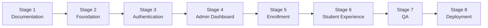

# Implementation Plan — Data Horizon Academy

> **Version:** 1.0  
> **Last Updated:** 2026-10-23  
> **Status:** Approved

---

## Overview

The Data Horizon Academy LMS is implemented in **8 stages**, progressing from documentation through to deployment. Each stage builds upon the previous one and includes a checklist of subtasks.



---

## Stage 1: Documentation ✅

> **Status:** Complete  
> **Goal:** Establish comprehensive project documentation before writing any code.

- [x] Product Requirements Document (`PRODUCT_REQUIREMENTS.md`)
- [x] Technical Architecture Document (`ARCHITECTURE.md`)
- [x] Data Model Document (`DATA_MODEL.md`)
- [x] Security Document (`SECURITY.md`)
- [x] Deployment Guide (`DEPLOYMENT.md`)
- [x] Implementation Plan (`IMPLEMENTATION_PLAN.md`)

---

## Stage 2: Project Foundation

> **Status:** Not Started  
> **Goal:** Set up the Next.js project with all core dependencies, configuration, layouts, and shared types.

### 2.1 Project Initialization

- [ ] Initialize Next.js project with App Router and TypeScript
  ```bash
  npx create-next-app@latest data-horizon-academy --typescript --tailwind --eslint --app --src-dir --import-alias "@/*"
  ```
- [ ] Verify project builds and runs locally (`npm run dev`)
- [ ] Initialize Git repository and create `.gitignore`

### 2.2 Dependencies

- [ ] Install and configure **shadcn/ui**
  ```bash
  npx shadcn@latest init
  ```
- [ ] Install core shadcn/ui components:
  - [ ] Button, Card, Input, Label, Form
  - [ ] Dialog, Dropdown Menu, Sheet
  - [ ] Table, Badge, Separator
  - [ ] Tabs, Accordion, Progress
  - [ ] Toast (Sonner), Avatar, Skeleton
- [ ] Install **Firebase** client SDK
  ```bash
  npm install firebase
  ```
- [ ] Install **Firebase Admin** SDK
  ```bash
  npm install firebase-admin
  ```
- [ ] Install **React Hook Form** and **Zod**
  ```bash
  npm install react-hook-form @hookform/resolvers zod
  ```
- [ ] Install **Lucide React** icons (included with shadcn/ui)

### 2.3 Firebase Configuration

- [ ] Create `lib/firebase/client.ts` — Firebase Client SDK initialization
  - [ ] Initialize Firebase app with `NEXT_PUBLIC_*` environment variables
  - [ ] Export `auth` (Firebase Auth instance)
  - [ ] Export `db` (Firestore instance)
- [ ] Create `lib/firebase/admin.ts` — Firebase Admin SDK initialization
  - [ ] Initialize Admin app with server-only `FIREBASE_ADMIN_*` variables
  - [ ] Export `adminAuth` (Admin Auth instance)
  - [ ] Export `adminDb` (Admin Firestore instance)
  - [ ] Add `import 'server-only'` to prevent client-side imports
- [ ] Create `.env.local` with all environment variables
- [ ] Create `.env.example` with placeholder values (no secrets)

### 2.4 Shared Types

- [ ] Create `lib/types/user.ts` — User interface
- [ ] Create `lib/types/course.ts` — Course, Week, Module, Lesson interfaces
- [ ] Create `lib/types/resource.ts` — Resource interface
- [ ] Create `lib/types/enrollment.ts` — Enrollment, EnrollmentCode interfaces
- [ ] Create `lib/types/progress.ts` — LessonProgress interface

### 2.5 Zod Schemas

- [ ] Create `lib/schemas/course.ts` — Course validation schema
- [ ] Create `lib/schemas/lesson.ts` — Lesson validation schema (includes YouTube ID validation)
- [ ] Create `lib/schemas/resource.ts` — Resource validation schema
- [ ] Create `lib/schemas/enrollment.ts` — Enrollment code schemas
- [ ] Create `lib/schemas/auth.ts` — Sign-in/sign-up form schemas

### 2.6 Utility Functions

- [ ] Create `lib/utils/youtube.ts` — YouTube URL parsing and video ID extraction
- [ ] Create `lib/utils/slug.ts` — URL slug generation from course name
- [ ] Create `lib/utils/hash.ts` — SHA-256 hashing utility for enrollment codes
- [ ] Create `lib/utils/cn.ts` — Class name utility (from shadcn/ui setup)

### 2.7 Layouts

- [ ] Create root layout (`app/layout.tsx`)
  - [ ] Include global styles, fonts (`next/font`)
  - [ ] Add metadata (title, description)
  - [ ] Wrap with providers (ThemeProvider, Sonner Toaster)
- [ ] Create public layout (`app/(public)/layout.tsx`)
  - [ ] Minimal header with logo and sign-in link
  - [ ] Clean, centered content area
- [ ] Create student layout (`app/(student)/layout.tsx`)
  - [ ] Header with user menu (avatar, sign-out)
  - [ ] Sidebar navigation (Dashboard, Courses)
  - [ ] Responsive mobile layout (sheet sidebar)
- [ ] Create admin layout (`app/(admin)/layout.tsx`)
  - [ ] Admin header with admin badge
  - [ ] Admin sidebar navigation (Dashboard, Courses, Enrollment Codes, Users)
  - [ ] Responsive mobile layout

### 2.8 Placeholder Pages

- [ ] Create landing page (`app/(public)/page.tsx`) — basic placeholder
- [ ] Create sign-in page (`app/(public)/sign-in/page.tsx`) — basic placeholder
- [ ] Create sign-up page (`app/(public)/sign-up/page.tsx`) — basic placeholder
- [ ] Create student dashboard (`app/(student)/dashboard/page.tsx`) — basic placeholder
- [ ] Create admin dashboard (`app/(admin)/admin/page.tsx`) — basic placeholder
- [ ] Create 404 page (`app/not-found.tsx`)
- [ ] Create error boundary (`app/error.tsx`)

### 2.9 Verification

- [ ] `npm run build` succeeds with no errors
- [ ] `npm run lint` passes
- [ ] TypeScript compilation has no errors
- [ ] All layouts render correctly at mobile and desktop sizes
- [ ] Firebase Client SDK initializes without errors in browser console
- [ ] Firebase Admin SDK initializes without errors in API route test

---

## Stage 3: Authentication

> **Status:** Not Started  
> **Goal:** Implement complete authentication flow with Firebase Auth, session management, protected routes, and admin bootstrap.

### 3.1 Auth Context

- [ ] Create `AuthProvider` client component (`components/auth/auth-provider.tsx`)
  - [ ] Use `onAuthStateChanged` to track auth state
  - [ ] Provide `user`, `loading`, `signIn`, `signOut` to context
  - [ ] Handle session cookie creation on sign-in
  - [ ] Handle session cookie deletion on sign-out
- [ ] Create `useAuth` hook (`lib/hooks/useAuth.ts`)
- [ ] Wrap the root layout with `AuthProvider`

### 3.2 Sign-In Page

- [ ] Build sign-in form (`app/(public)/sign-in/page.tsx`)
  - [ ] Google sign-in button (`signInWithPopup`)
  - [ ] Email/password form with Zod validation
  - [ ] Error handling and display
  - [ ] Redirect to dashboard on success
  - [ ] Link to sign-up page

### 3.3 Sign-Up Page

- [ ] Build sign-up form (`app/(public)/sign-up/page.tsx`)
  - [ ] Email, password, display name fields
  - [ ] Zod validation (password strength, email format)
  - [ ] `createUserWithEmailAndPassword` + `updateProfile`
  - [ ] Auto-create Firestore user document
  - [ ] Redirect to dashboard on success
  - [ ] Link to sign-in page

### 3.4 Session API Routes

- [ ] Create `POST /api/auth/session` — Create session cookie
  - [ ] Receive ID token in request body
  - [ ] Verify ID token with `adminAuth.verifyIdToken()`
  - [ ] Create session cookie with `adminAuth.createSessionCookie()`
  - [ ] Set HttpOnly, Secure, SameSite=Lax cookie
- [ ] Create `DELETE /api/auth/session` — Clear session cookie
  - [ ] Clear the session cookie
  - [ ] Return success response

### 3.5 User Document Management

- [ ] Create Firestore user document on first sign-in
  - [ ] Check if `/users/{uid}` exists
  - [ ] If not, create with: uid, email, displayName, photoURL, role: 'student', status: 'active', createdAt, lastLoginAt
  - [ ] If exists, update `lastLoginAt`

### 3.6 Middleware

- [ ] Create `middleware.ts` for route protection
  - [ ] Check session cookie presence
  - [ ] Allow public paths (`/`, `/sign-in`, `/sign-up`)
  - [ ] Redirect unauthenticated users to `/sign-in`
  - [ ] Configure matcher to exclude `_next/static`, `api`, etc.

### 3.7 Admin Route Protection

- [ ] Create admin layout auth guard (`app/(admin)/layout.tsx`)
  - [ ] Verify session cookie via API call or server-side check
  - [ ] Check `role === 'admin'` in custom claims
  - [ ] Redirect non-admin users to student dashboard
  - [ ] Show "Access Denied" if not admin

### 3.8 Admin Bootstrap Script

- [ ] Create `scripts/set-admin.ts`
  - [ ] Accept email as command argument
  - [ ] Look up user by email via Admin SDK
  - [ ] Set custom claims `{ role: 'admin' }`
  - [ ] Update Firestore user document `role` field
  - [ ] Print success/failure message
- [ ] Add script instructions to README
- [ ] Test script locally with a test account

### 3.9 Verification

- [ ] Google sign-in works end-to-end
- [ ] Email/password sign-up and sign-in work
- [ ] Session cookie is set on sign-in (check browser DevTools)
- [ ] Session cookie is cleared on sign-out
- [ ] Unauthenticated access to `/dashboard` redirects to `/sign-in`
- [ ] Non-admin access to `/admin` is blocked
- [ ] Admin bootstrap script successfully sets custom claims
- [ ] Admin can access `/admin` after re-signing in
- [ ] User document is created in Firestore on first sign-in
- [ ] `lastLoginAt` is updated on subsequent sign-ins

---

## Stage 4: Admin Dashboard

> **Status:** Not Started  
> **Goal:** Build the complete admin content management interface for courses, weeks, modules, lessons, and resources.

### 4.1 Admin Dashboard Home

- [ ] Create admin dashboard page (`app/(admin)/admin/page.tsx`)
  - [ ] Summary stats: total courses, total students, total enrollments
  - [ ] Quick links to course management, enrollment codes, users
  - [ ] Recent activity or quick-start guide

### 4.2 Course Management

- [ ] Create course list page (`app/(admin)/admin/courses/page.tsx`)
  - [ ] Table of all courses with: name, batch, status (published/draft), actions
  - [ ] "Create Course" button
  - [ ] Edit and delete actions per course
- [ ] Create course form component (`components/admin/course-form.tsx`)
  - [ ] Fields: name, slug (auto-generated from name, editable), description, cover image URL, instructor name, batch name, start date, end date, isPublished toggle
  - [ ] Zod validation via React Hook Form
  - [ ] YouTube-style slug auto-generation from course name
- [ ] Create course creation page (`app/(admin)/admin/courses/new/page.tsx`)
- [ ] Create course edit page (`app/(admin)/admin/courses/[courseId]/page.tsx`)
- [ ] Create course API routes
  - [ ] `POST /api/admin/courses` — Create course
  - [ ] `PUT /api/admin/courses/[courseId]` — Update course
  - [ ] `DELETE /api/admin/courses/[courseId]` — Delete course (with cascade)

### 4.3 Week Management

- [ ] Create week management UI within course edit page
  - [ ] List weeks for the course, ordered by `weekNumber`
  - [ ] Add week form (title, description, weekNumber, isPublished)
  - [ ] Edit week inline or in dialog
  - [ ] Delete week (with cascade warning)
  - [ ] Reorder weeks (update weekNumber)
- [ ] Create week API routes
  - [ ] `POST /api/admin/weeks` — Create week
  - [ ] `PUT /api/admin/weeks/[weekId]` — Update week
  - [ ] `DELETE /api/admin/weeks/[weekId]` — Delete week (cascade: modules, lessons, resources)

### 4.4 Module Management

- [ ] Create module management UI within week context
  - [ ] List modules for a week, ordered by `orderIndex`
  - [ ] Add module form (title, description, orderIndex, isPublished)
  - [ ] Edit module inline or in dialog
  - [ ] Delete module (with cascade warning)
  - [ ] Reorder modules (update orderIndex)
- [ ] Create module API routes
  - [ ] `POST /api/admin/modules` — Create module
  - [ ] `PUT /api/admin/modules/[moduleId]` — Update module
  - [ ] `DELETE /api/admin/modules/[moduleId]` — Delete module (cascade: lessons)

### 4.5 Lesson Management

- [ ] Create lesson management UI within module context
  - [ ] List lessons for a module, ordered by `orderIndex`
  - [ ] Add lesson form:
    - [ ] Title, description
    - [ ] YouTube URL input with real-time video ID extraction and preview
    - [ ] Duration (manual input)
    - [ ] Order index
    - [ ] isPublished toggle
  - [ ] Edit lesson inline or in dialog
  - [ ] Delete lesson
  - [ ] Reorder lessons
- [ ] Create YouTube URL handling
  - [ ] Accept URL or video ID input
  - [ ] Extract and validate video ID
  - [ ] Show video thumbnail preview from `https://img.youtube.com/vi/{id}/mqdefault.jpg`
  - [ ] Reject invalid URLs or non-YouTube domains
- [ ] Create lesson API routes
  - [ ] `POST /api/admin/lessons` — Create lesson
  - [ ] `PUT /api/admin/lessons/[lessonId]` — Update lesson
  - [ ] `DELETE /api/admin/lessons/[lessonId]` — Delete lesson (cascade: progress, resources)

### 4.6 Resource Management

- [ ] Create resource management UI
  - [ ] Add resource form:
    - [ ] Title, description
    - [ ] Google Drive URL
    - [ ] File type dropdown (PDF, Notebook, Slide, Dataset, Code, Other)
    - [ ] Category dropdown (Reading, Assignment, Reference, Tool, Other)
    - [ ] Scope: Course-level, Week-level, or Lesson-level
    - [ ] Order index
  - [ ] List resources grouped by scope
  - [ ] Edit and delete resources
- [ ] Create resource API routes
  - [ ] `POST /api/admin/resources` — Create resource
  - [ ] `PUT /api/admin/resources/[resourceId]` — Update resource
  - [ ] `DELETE /api/admin/resources/[resourceId]` — Delete resource

### 4.7 User Management

- [ ] Create user list page (`app/(admin)/admin/users/page.tsx`)
  - [ ] Table of all users: display name, email, role, status, created at, last login
  - [ ] Suspend/reactivate toggle per user
  - [ ] Search/filter users
- [ ] Create user management API routes
  - [ ] `GET /api/admin/users` — List users (paginated)
  - [ ] `PATCH /api/admin/users/[userId]` — Update user status

### 4.8 Verification

- [ ] Admin can create, edit, and delete courses
- [ ] Course slug is auto-generated and unique
- [ ] Admin can manage weeks with proper ordering
- [ ] Admin can manage modules within weeks
- [ ] Admin can manage lessons with YouTube URL parsing
- [ ] YouTube video ID is correctly extracted from various URL formats
- [ ] Video thumbnail preview shows correctly
- [ ] Admin can manage resources with Google Drive links
- [ ] Resources can be scoped to course, week, or lesson level
- [ ] Publish/unpublish toggles work at all content levels
- [ ] Cascade deletes work correctly
- [ ] User list displays all users
- [ ] Admin can suspend and reactivate users
- [ ] All forms show validation errors correctly
- [ ] API routes return appropriate error responses

---

## Stage 5: Enrollment System

> **Status:** Not Started  
> **Goal:** Implement enrollment code generation, management, and student redemption.

### 5.1 Enrollment Code Generation (Admin)

- [ ] Create enrollment code management page (`app/(admin)/admin/enrollment-codes/page.tsx`)
  - [ ] Table of all codes: prefix, course, batch, max/current redemptions, status, created at, expires at
  - [ ] "Generate Code" button
  - [ ] Code generation form:
    - [ ] Select course (dropdown)
    - [ ] Batch name
    - [ ] Max redemptions (number)
    - [ ] Expiration date (date picker)
  - [ ] Show generated plaintext code in a copyable dialog (shown once only)
  - [ ] Revoke code action
- [ ] Create enrollment code API routes
  - [ ] `POST /api/admin/enrollment-codes` — Generate code (returns plaintext once)
  - [ ] `PATCH /api/admin/enrollment-codes/[id]` — Revoke code (set status to 'revoked')
  - [ ] `GET /api/admin/enrollment-codes` — List codes for admin

### 5.2 Enrollment Code Redemption (Student)

- [ ] Create enrollment UI on student dashboard or dedicated page
  - [ ] Single text input for enrollment code
  - [ ] "Enroll" button
  - [ ] Success feedback: course card appears in dashboard
  - [ ] Error feedback: invalid/expired/used-up code messages
- [ ] Create redemption API route (`POST /api/enrollment/redeem`)
  - [ ] Verify student authentication
  - [ ] Validate and trim the code input (Zod)
  - [ ] Hash the input code (SHA-256)
  - [ ] Run Firestore transaction:
    - [ ] Find matching active code by hash
    - [ ] Validate: not expired, not at max redemptions
    - [ ] Check for existing enrollment (prevent duplicates)
    - [ ] Increment `currentRedemptions`
    - [ ] Create enrollment document
  - [ ] Implement rate limiting (5 attempts per minute per user)
  - [ ] Return course info on success

### 5.3 Enrollment Status Management

- [ ] Admin can view enrollments per course
  - [ ] Table of enrolled students: name, email, batch, enrolled at, status
- [ ] Admin can view enrollment codes per course from the course management page

### 5.4 Verification

- [ ] Admin can generate enrollment codes
- [ ] Plaintext code is shown once and only once
- [ ] Code prefix (4 chars) is shown in the admin list
- [ ] Student can redeem a valid code and enroll in a course
- [ ] Invalid code shows error message
- [ ] Expired code shows error message
- [ ] Code at max redemptions shows error message
- [ ] Duplicate enrollment is prevented
- [ ] Admin can revoke a code
- [ ] Revoked code cannot be redeemed
- [ ] Rate limiting prevents brute-force code attempts
- [ ] Enrollment appears in admin's enrollment list

---

## Stage 6: Student Experience

> **Status:** Not Started  
> **Goal:** Build the student-facing interface for browsing courses, watching videos, accessing materials, and tracking progress.

### 6.1 Student Dashboard

- [ ] Build dashboard page (`app/(student)/dashboard/page.tsx`)
  - [ ] Grid of enrolled course cards
  - [ ] Each card shows: course name, instructor, progress bar, batch name
  - [ ] Empty state: "No courses yet" with prompt to enter enrollment code
  - [ ] Enrollment code input form (inline or linked)
  - [ ] Fetch enrollments from Firestore (client SDK)

### 6.2 Course Overview Page

- [ ] Build course page (`app/(student)/courses/[slug]/page.tsx`)
  - [ ] Course header: name, description, instructor, batch, dates
  - [ ] Overall progress bar
  - [ ] Content navigation:
    - [ ] Accordion or sidebar listing weeks
    - [ ] Each week expands to show modules
    - [ ] Each module shows lesson list with completion checkmarks
  - [ ] Resources section (course-level resources)
- [ ] Verify enrollment before showing content
  - [ ] If not enrolled → redirect to dashboard or show "Not Enrolled" message

### 6.3 Lesson Viewer

- [ ] Build lesson page (`app/(student)/courses/[slug]/lessons/[lessonId]/page.tsx`)
  - [ ] YouTube video embed (responsive iframe)
  - [ ] Lesson title and description
  - [ ] "Mark as Complete" / "Mark as Incomplete" toggle button
  - [ ] Previous/Next lesson navigation
  - [ ] Resources section (lesson-level resources)
  - [ ] Sidebar with lesson list (current lesson highlighted)

### 6.4 Video Player Component

- [ ] Create YouTube embed component (`components/student/youtube-player.tsx`)
  - [ ] Responsive 16:9 aspect ratio iframe
  - [ ] Loading skeleton while iframe loads
  - [ ] Proper iframe attributes (allow, referrerPolicy, loading)
  - [ ] Title attribute for accessibility
  - [ ] Error state for invalid video IDs

### 6.5 Resource List Component

- [ ] Create resource list component (`components/student/resource-list.tsx`)
  - [ ] List of resources with: icon (by file type), title, description, category badge
  - [ ] Each resource links to Google Drive (opens in new tab)
  - [ ] Group by category or show flat list
  - [ ] File type icons (PDF, notebook, slide, etc.)

### 6.6 Progress Tracking

- [ ] Create progress API route (`POST /api/progress`)
  - [ ] Accept lessonId, courseId, completed (boolean)
  - [ ] Verify student is enrolled in the course
  - [ ] Create or update `lessonProgress` document
  - [ ] Use deterministic document ID: `{lessonId}_{userId}`
- [ ] Create progress hook (`lib/hooks/useProgress.ts`)
  - [ ] Fetch all lesson progress for a course
  - [ ] Calculate completion percentage
  - [ ] Toggle individual lesson completion
- [ ] Create "Mark as Complete" button component
  - [ ] Toggle state with optimistic update
  - [ ] Call progress API route
  - [ ] Show loading spinner during update
  - [ ] Handle errors with toast notification

### 6.7 Course Progress Calculation

- [ ] Calculate progress on the course overview page:
  - [ ] Count total published lessons in the course
  - [ ] Count completed lessons for the user in the course
  - [ ] Display as percentage and progress bar
- [ ] Show completion checkmarks next to lessons in the navigation

### 6.8 Verification

- [ ] Dashboard shows enrolled courses with correct progress
- [ ] Course page shows published content hierarchy
- [ ] Unpublished weeks/modules/lessons are not visible
- [ ] YouTube videos embed and play correctly
- [ ] Lesson navigation (previous/next) works
- [ ] Resources display with correct icons and categories
- [ ] Google Drive links open in new tab
- [ ] "Mark as Complete" toggles lesson completion
- [ ] Progress bar updates after marking lessons
- [ ] Course progress percentage is accurate
- [ ] Non-enrolled students cannot access course content
- [ ] Suspended students cannot access content

---

## Stage 7: Quality Assurance

> **Status:** Not Started  
> **Goal:** Verify code quality, fix issues, and ensure the application is production-ready.

### 7.1 TypeScript

- [ ] Run `npx tsc --noEmit` — zero TypeScript errors
- [ ] All components have proper TypeScript types
- [ ] No usage of `any` type (except where absolutely necessary)
- [ ] All API route request/response types defined
- [ ] All Firestore document types match schema definitions

### 7.2 Linting

- [ ] Run `npm run lint` — zero ESLint errors or warnings
- [ ] Ensure consistent code style throughout
- [ ] No unused imports or variables
- [ ] No console.log statements (except in error handling)

### 7.3 Build Verification

- [ ] Run `npm run build` — successful production build
- [ ] No build warnings related to bundle size
- [ ] Firebase Admin SDK is not included in client bundles
- [ ] Verify server-only imports with `import 'server-only'`

### 7.4 Functional Testing (Manual)

- [ ] Complete end-to-end flow:
  1. [ ] Admin signs in
  2. [ ] Admin creates a course with full content hierarchy
  3. [ ] Admin generates enrollment code
  4. [ ] Student signs up
  5. [ ] Student redeems code
  6. [ ] Student views course content
  7. [ ] Student watches video
  8. [ ] Student marks lessons complete
  9. [ ] Student sees progress update
  10. [ ] Admin verifies enrollment in admin panel
- [ ] Test with Google sign-in
- [ ] Test with email/password sign-in
- [ ] Test error scenarios (invalid code, expired code, duplicate enrollment)
- [ ] Test responsive layouts (mobile, tablet, desktop)

### 7.5 Security Testing

- [ ] Verify Firestore security rules block unauthorized access
  - [ ] Test with Firebase Console Rules Playground
- [ ] Verify API routes return 401 without authentication
- [ ] Verify admin routes return 403 for non-admin users
- [ ] Verify students cannot access unpublished content
- [ ] Verify students cannot access courses they're not enrolled in
- [ ] Verify CSRF protection on state-changing routes

### 7.6 Performance

- [ ] Run Lighthouse audit on key pages
  - [ ] Landing page: Performance > 90
  - [ ] Dashboard: Performance > 80
  - [ ] Lesson page: Performance > 80
- [ ] Verify lazy loading of images and iframes
- [ ] Check for unnecessary re-renders in React DevTools
- [ ] Verify Firestore read count is reasonable for common flows

### 7.7 Accessibility

- [ ] Keyboard navigation works for all interactive elements
- [ ] Screen reader compatibility (check with browser reader)
- [ ] Color contrast meets WCAG AA standards
- [ ] All images have alt text
- [ ] All form inputs have labels
- [ ] Focus management on dialog open/close

---

## Stage 8: Deployment Preparation

> **Status:** Not Started  
> **Goal:** Prepare and execute production deployment.

### 8.1 Firebase Setup

- [ ] Create production Firebase project (if separate from development)
- [ ] Enable Auth providers (Google + Email/Password)
- [ ] Create Firestore database in production mode
- [ ] Generate service account key for production

### 8.2 Firestore Rules and Indexes

- [ ] Write final `firestore.rules` file
- [ ] Write final `firestore.indexes.json` file
- [ ] Deploy security rules: `firebase deploy --only firestore:rules`
- [ ] Deploy indexes: `firebase deploy --only firestore:indexes`
- [ ] Verify indexes are built (Firebase Console → Firestore → Indexes)

### 8.3 Vercel Deployment

- [ ] Connect GitHub repository to Vercel
- [ ] Configure all environment variables in Vercel
- [ ] Set `NEXT_PUBLIC_APP_URL` to production URL
- [ ] Trigger initial deployment
- [ ] Verify deployment succeeds

### 8.4 Post-Deployment Configuration

- [ ] Add Vercel domain to Firebase Auth authorized domains
- [ ] Bootstrap admin user with CLI script
- [ ] Verify admin access on production
- [ ] Configure custom domain (if applicable)
- [ ] Update `NEXT_PUBLIC_APP_URL` if using custom domain

### 8.5 Production Smoke Tests

- [ ] Run through the full smoke test checklist (see [DEPLOYMENT.md](./DEPLOYMENT.md))
- [ ] Verify all auth flows work
- [ ] Verify admin CRUD operations
- [ ] Verify enrollment flow
- [ ] Verify student experience
- [ ] Verify security (blocked unauthorized access)

### 8.6 Go-Live

- [ ] Create initial course content (admin)
- [ ] Generate enrollment codes for first batch
- [ ] Distribute codes to students
- [ ] Monitor Firestore usage dashboard
- [ ] Monitor Vercel usage dashboard

---

## Stage Dependencies

| Stage | Depends On | Blocks |
|-------|-----------|--------|
| Stage 1: Documentation | None | Stage 2 |
| Stage 2: Foundation | Stage 1 | Stage 3 |
| Stage 3: Authentication | Stage 2 | Stage 4, Stage 5, Stage 6 |
| Stage 4: Admin Dashboard | Stage 3 | Stage 5, Stage 7 |
| Stage 5: Enrollment | Stage 3, Stage 4 | Stage 6, Stage 7 |
| Stage 6: Student Experience | Stage 3, Stage 5 | Stage 7 |
| Stage 7: QA | Stage 4, Stage 5, Stage 6 | Stage 8 |
| Stage 8: Deployment | Stage 7 | None |

---

## Estimated Effort

| Stage | Description | Estimated Duration |
|-------|-------------|-------------------|
| Stage 1 | Documentation | ✅ Complete |
| Stage 2 | Project Foundation | 1-2 days |
| Stage 3 | Authentication | 1-2 days |
| Stage 4 | Admin Dashboard | 3-4 days |
| Stage 5 | Enrollment System | 1-2 days |
| Stage 6 | Student Experience | 2-3 days |
| Stage 7 | Quality Assurance | 1-2 days |
| Stage 8 | Deployment Preparation | 1 day |
| **Total** | | **10-16 days** |

> **Note:** Estimates assume a single developer working on the project. Actual time may vary based on complexity encountered during implementation.
