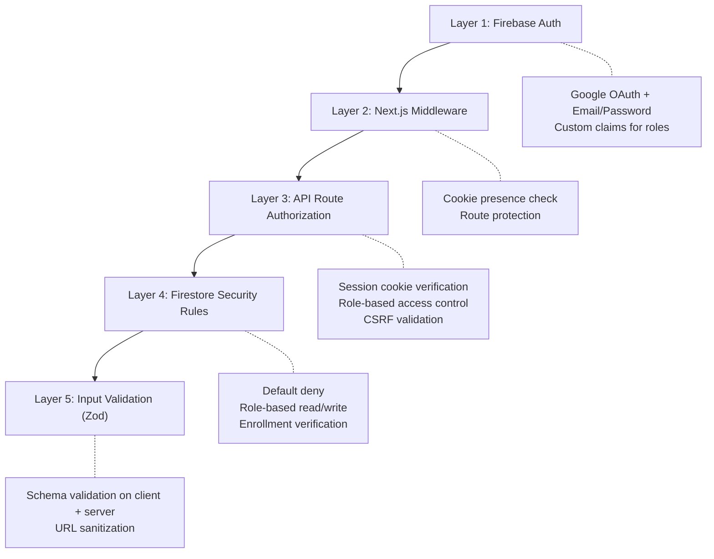

# Security — Data Horizon Academy

> **Version:** 1.0  
> **Last Updated:** 2026-10-23  
> **Status:** Approved

---

## 1. Security Architecture Overview

Data Horizon Academy implements a **defense-in-depth** security model with multiple layers:



---

## 2. Firebase Authentication

### 2.1 Auth Providers

| Provider | Configuration | Use Case |
|----------|--------------|----------|
| **Google Sign-In** | Firebase Console → Authentication → Google provider | Primary sign-in method |
| **Email/Password** | Firebase Console → Authentication → Email/Password provider | Alternative sign-in method |

### 2.2 Custom Claims

Firebase Auth custom claims are used to encode the user's role into their auth token:

```typescript
// Custom claims structure
interface CustomClaims {
  role: 'admin' | 'student';
}
```

**How custom claims work:**

1. Claims are set on the user's Firebase Auth account using the **Admin SDK**
2. Claims are included in the user's **ID token** and **session cookie**
3. Claims are available on the server via `decodedToken.role`
4. Claims propagate to the client on the next token refresh (up to 1 hour delay)

### 2.3 Admin Bootstrap Process

The first administrator is created via a CLI script run locally. This script uses the Firebase Admin SDK to set the `admin` custom claim on a user account.

#### Prerequisites

- Node.js installed locally
- Firebase Admin SDK service account key (JSON file)
- The target user must have already signed in at least once (so their account exists)

#### Bootstrap Script

```typescript
// scripts/set-admin.ts

import { initializeApp, cert } from 'firebase-admin/app';
import { getAuth } from 'firebase-admin/auth';
import * as path from 'path';

// Load service account key
const serviceAccount = require(path.resolve(__dirname, '../service-account-key.json'));

const app = initializeApp({
  credential: cert(serviceAccount),
});

const auth = getAuth(app);

async function setAdminRole(email: string) {
  try {
    // Look up the user by email
    const user = await auth.getUserByEmail(email);
    
    // Set custom claims
    await auth.setCustomUserClaims(user.uid, { role: 'admin' });
    
    console.log(`✅ Successfully set admin role for ${email} (UID: ${user.uid})`);
    console.log('⚠️  The user must sign out and sign back in for the claim to take effect.');
  } catch (error) {
    console.error('❌ Error setting admin role:', error);
    process.exit(1);
  }
}

// Get email from command line argument
const email = process.argv[2];
if (!email) {
  console.error('Usage: npx ts-node scripts/set-admin.ts <email>');
  process.exit(1);
}

setAdminRole(email);
```

#### Usage

```bash
# Run the bootstrap script
npx ts-node scripts/set-admin.ts admin@datahorizon.com
```

> **Important:** The service account key JSON file (`service-account-key.json`) must **never** be committed to version control. Add it to `.gitignore`.

---

## 3. Session Management

### 3.1 Session Cookie Flow

```
1. User signs in via Firebase Auth (client-side)
2. Client obtains the ID token: await user.getIdToken()
3. Client sends ID token to POST /api/auth/session
4. Server verifies ID token with Firebase Admin SDK
5. Server creates a session cookie with createSessionCookie()
   - Max age: 5 days (432000 seconds)
   - Options: { maxAge: 432000, httpOnly: true, secure: true, sameSite: 'lax', path: '/' }
6. Cookie is set in the response
7. All subsequent requests include the cookie automatically
8. API routes verify the cookie with verifySessionCookie()
```

### 3.2 Session Cookie Security Properties

| Property | Value | Purpose |
|----------|-------|---------|
| `httpOnly` | `true` | Prevents JavaScript access (XSS mitigation) |
| `secure` | `true` | Cookie only sent over HTTPS |
| `sameSite` | `'lax'` | CSRF protection; cookie sent on top-level navigations |
| `path` | `'/'` | Cookie available across all paths |
| `maxAge` | `432000` (5 days) | Session expiration |

### 3.3 Sign-Out

```typescript
// Client-side sign-out
await firebaseAuth.signOut();
await fetch('/api/auth/session', { method: 'DELETE' });
// Server clears the session cookie
```

---

## 4. API Route Authorization

### 4.1 Authorization Pattern

Every API route follows a standard authorization pattern:

```typescript
import { NextRequest, NextResponse } from 'next/server';
import { adminAuth } from '@/lib/firebase/admin';

async function verifyAuth(request: NextRequest) {
  const sessionCookie = request.cookies.get('session')?.value;
  
  if (!sessionCookie) {
    return null;
  }

  try {
    // checkRevoked: true ensures revoked sessions are rejected
    const decodedClaims = await adminAuth.verifySessionCookie(sessionCookie, true);
    return decodedClaims;
  } catch (error) {
    return null;
  }
}

function verifyAdmin(decodedClaims: any): boolean {
  return decodedClaims?.role === 'admin';
}

// In the route handler:
export async function POST(request: NextRequest) {
  // 1. Verify authentication
  const claims = await verifyAuth(request);
  if (!claims) {
    return NextResponse.json({ error: 'Unauthorized' }, { status: 401 });
  }

  // 2. Verify authorization (for admin routes)
  if (!verifyAdmin(claims)) {
    return NextResponse.json({ error: 'Forbidden' }, { status: 403 });
  }

  // 3. Verify CSRF
  // (see section 5)

  // 4. Validate input
  // (see section 7)

  // 5. Process request
  // ...
}
```

### 4.2 Route Authorization Matrix

| Route | Method | Auth Required | Role Required | CSRF Check |
|-------|--------|---------------|---------------|------------|
| `POST /api/auth/session` | POST | No (receives ID token) | None | Yes |
| `DELETE /api/auth/session` | DELETE | Yes | None | Yes |
| `POST /api/admin/courses` | POST | Yes | Admin | Yes |
| `PUT /api/admin/courses/[id]` | PUT | Yes | Admin | Yes |
| `DELETE /api/admin/courses/[id]` | DELETE | Yes | Admin | Yes |
| `POST /api/admin/weeks` | POST | Yes | Admin | Yes |
| `PUT /api/admin/weeks/[id]` | PUT | Yes | Admin | Yes |
| `DELETE /api/admin/weeks/[id]` | DELETE | Yes | Admin | Yes |
| `POST /api/admin/modules` | POST | Yes | Admin | Yes |
| `PUT /api/admin/modules/[id]` | PUT | Yes | Admin | Yes |
| `DELETE /api/admin/modules/[id]` | DELETE | Yes | Admin | Yes |
| `POST /api/admin/lessons` | POST | Yes | Admin | Yes |
| `PUT /api/admin/lessons/[id]` | PUT | Yes | Admin | Yes |
| `DELETE /api/admin/lessons/[id]` | DELETE | Yes | Admin | Yes |
| `POST /api/admin/resources` | POST | Yes | Admin | Yes |
| `PUT /api/admin/resources/[id]` | PUT | Yes | Admin | Yes |
| `DELETE /api/admin/resources/[id]` | DELETE | Yes | Admin | Yes |
| `POST /api/admin/enrollment-codes` | POST | Yes | Admin | Yes |
| `PATCH /api/admin/enrollment-codes/[id]` | PATCH | Yes | Admin | Yes |
| `POST /api/enrollment/redeem` | POST | Yes | Student | Yes |
| `POST /api/progress` | POST | Yes | Student | Yes |

---

## 5. CSRF Protection

### 5.1 Origin Header Validation

All state-changing API routes (POST, PUT, PATCH, DELETE) validate the `Origin` header:

```typescript
function verifyCsrf(request: NextRequest): boolean {
  const origin = request.headers.get('origin');
  const allowedOrigin = process.env.NEXT_PUBLIC_APP_URL;

  if (!origin || origin !== allowedOrigin) {
    return false;
  }

  return true;
}

// In route handler:
export async function POST(request: NextRequest) {
  if (!verifyCsrf(request)) {
    return NextResponse.json({ error: 'CSRF validation failed' }, { status: 403 });
  }
  // ... proceed
}
```

### 5.2 Why Origin Header?

- **SameSite=Lax cookies** prevent the cookie from being sent in cross-origin POST requests
- **Origin header validation** provides an additional layer of CSRF protection
- Together, these measures prevent cross-site request forgery without requiring CSRF tokens

---

## 6. Enrollment Code Security

### 6.1 Code Generation

```typescript
import { randomBytes, createHash } from 'crypto';

function generateEnrollmentCode(): { plaintext: string; hash: string; prefix: string } {
  // Generate a cryptographically secure random code
  // 16 bytes = 32 hex characters (sufficient entropy)
  const plaintext = randomBytes(16).toString('hex').toUpperCase();
  
  // Hash the code for storage
  const hash = createHash('sha256').update(plaintext).digest('hex');
  
  // Keep first 4 characters as a prefix for admin identification
  const prefix = plaintext.substring(0, 4);
  
  return { plaintext, hash, prefix };
}
```

### 6.2 Code Redemption (Server-Side Transaction)

```typescript
async function redeemCode(userId: string, inputCode: string) {
  const hashedInput = createHash('sha256').update(inputCode.toUpperCase()).digest('hex');

  return adminDb.runTransaction(async (transaction) => {
    // 1. Find the enrollment code by hash
    const codesQuery = adminDb.collection('enrollmentCodes')
      .where('code', '==', hashedInput)
      .where('status', '==', 'active')
      .limit(1);
    
    const codeSnapshot = await transaction.get(codesQuery);
    
    if (codeSnapshot.empty) {
      throw new Error('Invalid or expired enrollment code');
    }

    const codeDoc = codeSnapshot.docs[0];
    const codeData = codeDoc.data();

    // 2. Validate the code
    if (codeData.currentRedemptions >= codeData.maxRedemptions) {
      throw new Error('This code has reached its maximum number of uses');
    }

    if (codeData.expiresAt.toDate() < new Date()) {
      throw new Error('This enrollment code has expired');
    }

    // 3. Check for existing enrollment
    const enrollmentQuery = adminDb.collection('enrollments')
      .where('userId', '==', userId)
      .where('courseId', '==', codeData.courseId)
      .limit(1);
    
    const enrollmentSnapshot = await transaction.get(enrollmentQuery);
    
    if (!enrollmentSnapshot.empty) {
      throw new Error('You are already enrolled in this course');
    }

    // 4. Atomically increment redemption count
    transaction.update(codeDoc.ref, {
      currentRedemptions: codeData.currentRedemptions + 1,
    });

    // 5. Create enrollment record
    const enrollmentRef = adminDb.collection('enrollments').doc();
    transaction.set(enrollmentRef, {
      userId,
      courseId: codeData.courseId,
      batchName: codeData.batchName,
      enrollmentCodeId: codeDoc.id,
      enrolledAt: FieldValue.serverTimestamp(),
      status: 'active',
    });

    return { courseId: codeData.courseId };
  });
}
```

### 6.3 Rate Limiting

Enrollment code redemption is rate-limited to prevent brute-force attacks:

```typescript
// Simple in-memory rate limiting for the enrollment endpoint
const rateLimitMap = new Map<string, { count: number; resetAt: number }>();

function checkRateLimit(userId: string): boolean {
  const now = Date.now();
  const windowMs = 60 * 1000; // 1 minute window
  const maxAttempts = 5; // 5 attempts per minute

  const entry = rateLimitMap.get(userId);
  
  if (!entry || now > entry.resetAt) {
    rateLimitMap.set(userId, { count: 1, resetAt: now + windowMs });
    return true;
  }

  if (entry.count >= maxAttempts) {
    return false; // Rate limited
  }

  entry.count++;
  return true;
}
```

> **Note:** This is a simple in-memory rate limiter. On Vercel Serverless Functions, each invocation may use a different instance, so this provides soft rate limiting. For stronger protection, implement rate limiting with Firestore counters or Vercel Edge Config.

---

## 7. Input Validation

### 7.1 Zod Schema Validation

All user input is validated with Zod schemas on **both client and server**:

```typescript
// lib/schemas/course.ts
import { z } from 'zod';

export const courseSchema = z.object({
  name: z.string().min(1, 'Course name is required').max(200),
  slug: z.string()
    .min(1, 'Slug is required')
    .max(100)
    .regex(/^[a-z0-9]+(?:-[a-z0-9]+)*$/, 'Slug must be lowercase alphanumeric with hyphens'),
  description: z.string().min(1, 'Description is required').max(5000),
  coverImageUrl: z.string().url().nullable().optional(),
  instructorName: z.string().min(1, 'Instructor name is required').max(100),
  batchName: z.string().min(1, 'Batch name is required').max(100),
  startDate: z.string().datetime().nullable().optional(),
  endDate: z.string().datetime().nullable().optional(),
  isPublished: z.boolean().default(false),
});

export type CourseInput = z.infer<typeof courseSchema>;
```

```typescript
// lib/schemas/lesson.ts
import { z } from 'zod';

const youtubeVideoIdPattern = /^[a-zA-Z0-9_-]{11}$/;

export const lessonSchema = z.object({
  moduleId: z.string().min(1),
  weekId: z.string().min(1),
  courseId: z.string().min(1),
  title: z.string().min(1, 'Title is required').max(200),
  description: z.string().max(5000).nullable().optional(),
  youtubeVideoId: z.string().regex(youtubeVideoIdPattern, 'Invalid YouTube video ID'),
  duration: z.string().max(20).nullable().optional(),
  orderIndex: z.number().int().min(0),
  isPublished: z.boolean().default(false),
});
```

```typescript
// lib/schemas/enrollment.ts
import { z } from 'zod';

export const enrollmentCodeInputSchema = z.object({
  code: z.string()
    .min(1, 'Enrollment code is required')
    .max(64)
    .transform(val => val.trim().toUpperCase()),
});

export const enrollmentCodeCreateSchema = z.object({
  courseId: z.string().min(1),
  batchName: z.string().min(1).max(100),
  maxRedemptions: z.number().int().min(1).max(1000),
  expiresAt: z.string().datetime(),
});
```

### 7.2 Server-Side Validation in API Routes

```typescript
// In API route handler
export async function POST(request: NextRequest) {
  // ... auth checks ...

  const body = await request.json();
  
  // Validate with Zod — throws ZodError if invalid
  const result = courseSchema.safeParse(body);
  
  if (!result.success) {
    return NextResponse.json(
      { error: 'Validation failed', details: result.error.flatten() },
      { status: 400 }
    );
  }

  const validatedData = result.data;
  // ... proceed with validated data
}
```

---

## 8. YouTube URL Sanitization

### 8.1 Allowed Domains

Only the following domains are accepted for YouTube URLs:

- `youtube.com` (and `www.youtube.com`)
- `youtu.be`

### 8.2 URL Validation and Video ID Extraction

```typescript
// lib/utils/youtube.ts

const YOUTUBE_PATTERNS = [
  // Standard watch URL: https://www.youtube.com/watch?v=VIDEO_ID
  /^(?:https?:\/\/)?(?:www\.)?youtube\.com\/watch\?(?:.*&)?v=([a-zA-Z0-9_-]{11})(?:&.*)?$/,
  // Short URL: https://youtu.be/VIDEO_ID
  /^(?:https?:\/\/)?youtu\.be\/([a-zA-Z0-9_-]{11})(?:\?.*)?$/,
  // Embed URL: https://www.youtube.com/embed/VIDEO_ID
  /^(?:https?:\/\/)?(?:www\.)?youtube\.com\/embed\/([a-zA-Z0-9_-]{11})(?:\?.*)?$/,
];

export function extractYouTubeVideoId(input: string): string | null {
  const trimmed = input.trim();

  // If it looks like just a video ID already (11 chars, valid characters)
  if (/^[a-zA-Z0-9_-]{11}$/.test(trimmed)) {
    return trimmed;
  }

  for (const pattern of YOUTUBE_PATTERNS) {
    const match = trimmed.match(pattern);
    if (match && match[1]) {
      return match[1];
    }
  }

  return null;
}

export function buildYouTubeEmbedUrl(videoId: string): string {
  // Only allow valid video IDs
  if (!/^[a-zA-Z0-9_-]{11}$/.test(videoId)) {
    throw new Error('Invalid YouTube video ID');
  }
  return `https://www.youtube.com/embed/${videoId}`;
}
```

### 8.3 YouTube Embed Security

The YouTube iframe embed uses security-conscious attributes:

```tsx
<iframe
  src={`https://www.youtube.com/embed/${videoId}`}
  title={lessonTitle}
  allow="accelerometer; autoplay; clipboard-write; encrypted-media; gyroscope; picture-in-picture"
  allowFullScreen
  referrerPolicy="strict-origin-when-cross-origin"
  loading="lazy"
  className="w-full aspect-video rounded-lg"
/>
```

---

## 9. Content Access Control

### 9.1 Student Content Visibility Rules

Students can only see content that meets **all** of the following conditions:

1. The student has an **active enrollment** in the course
2. The student's account status is **active** (not suspended)
3. The course `isPublished` is `true`
4. The week `isPublished` is `true`
5. The module `isPublished` is `true`
6. The lesson `isPublished` is `true`

### 9.2 Enforcement Layers

| Layer | How Content Access Is Enforced |
|-------|-------------------------------|
| **Firestore Security Rules** | Rules verify enrollment + published status on reads |
| **Client-Side Queries** | Queries filter for `isPublished == true` |
| **API Routes** | Server-side enrollment verification for write operations |
| **UI** | Unpublished content is hidden from the student UI |

---

## 10. Firestore Security Rules

```javascript
rules_version = '2';

service cloud.firestore {
  match /databases/{database}/documents {

    // ============================================================
    // Helper Functions
    // ============================================================

    // Check if the user is authenticated
    function isAuthenticated() {
      return request.auth != null;
    }

    // Check if the user has admin role
    function isAdmin() {
      return isAuthenticated() && request.auth.token.role == 'admin';
    }

    // Check if the user's account is active
    function isActiveUser() {
      return isAuthenticated() &&
        exists(/databases/$(database)/documents/users/$(request.auth.uid)) &&
        get(/databases/$(database)/documents/users/$(request.auth.uid)).data.status == 'active';
    }

    // Check if the user is enrolled in a specific course
    function isEnrolledInCourse(courseId) {
      return isAuthenticated() &&
        exists(/databases/$(database)/documents/enrollments/$(request.auth.uid + '_' + courseId)) == false &&
        // Since enrollment IDs are auto-generated, we can't do a direct doc read.
        // Instead, we rely on the query-based approach below.
        // This helper is for documentation purposes; actual enrollment checks
        // happen via queries in the application code or via the denormalized approach.
        true;
    }

    // ============================================================
    // Default: Deny all access
    // ============================================================
    match /{document=**} {
      allow read, write: if false;
    }

    // ============================================================
    // Users Collection
    // ============================================================
    match /users/{userId} {
      // Users can read their own document
      allow read: if isAuthenticated() && request.auth.uid == userId;

      // Users can create their own document on first sign-in
      allow create: if isAuthenticated() &&
        request.auth.uid == userId &&
        request.resource.data.uid == userId &&
        request.resource.data.email == request.auth.token.email &&
        request.resource.data.role == 'student' &&
        request.resource.data.status == 'active' &&
        request.resource.data.keys().hasAll(['uid', 'email', 'displayName', 'role', 'status', 'createdAt', 'lastLoginAt']);

      // Users can update their own lastLoginAt
      allow update: if isAuthenticated() &&
        request.auth.uid == userId &&
        request.resource.data.diff(resource.data).affectedKeys().hasOnly(['lastLoginAt']);

      // Admins can read all user documents
      allow read: if isAdmin();

      // Admins can update user status (suspend/reactivate)
      allow update: if isAdmin() &&
        request.resource.data.diff(resource.data).affectedKeys().hasOnly(['status']);
    }

    // ============================================================
    // Courses Collection
    // ============================================================
    match /courses/{courseId} {
      // Admins have full access
      allow read, write: if isAdmin();

      // Authenticated users can read published courses
      // (enrollment check happens in application code for listing)
      allow read: if isAuthenticated() &&
        resource.data.isPublished == true;
    }

    // ============================================================
    // Weeks Collection
    // ============================================================
    match /weeks/{weekId} {
      // Admins have full access
      allow read, write: if isAdmin();

      // Authenticated users can read published weeks
      allow read: if isAuthenticated() &&
        resource.data.isPublished == true;
    }

    // ============================================================
    // Modules Collection
    // ============================================================
    match /modules/{moduleId} {
      // Admins have full access
      allow read, write: if isAdmin();

      // Authenticated users can read published modules
      allow read: if isAuthenticated() &&
        resource.data.isPublished == true;
    }

    // ============================================================
    // Lessons Collection
    // ============================================================
    match /lessons/{lessonId} {
      // Admins have full access
      allow read, write: if isAdmin();

      // Authenticated users can read published lessons
      allow read: if isAuthenticated() &&
        resource.data.isPublished == true;
    }

    // ============================================================
    // Resources Collection
    // ============================================================
    match /resources/{resourceId} {
      // Admins have full access
      allow read, write: if isAdmin();

      // Authenticated users can read resources
      // (enrollment verification happens via the parent course/week/lesson checks)
      allow read: if isAuthenticated();
    }

    // ============================================================
    // Enrollment Codes Collection
    // ============================================================
    match /enrollmentCodes/{codeId} {
      // Only admins can read and manage enrollment codes
      allow read, write: if isAdmin();

      // No student access — codes are validated server-side via Admin SDK
    }

    // ============================================================
    // Enrollments Collection
    // ============================================================
    match /enrollments/{enrollmentId} {
      // Users can read their own enrollments
      allow read: if isAuthenticated() &&
        resource.data.userId == request.auth.uid;

      // Admins can read all enrollments
      allow read: if isAdmin();

      // Only server (Admin SDK) can create/update/delete enrollments
      // (enrollment creation happens in the redeem API route)
      allow write: if false;
    }

    // ============================================================
    // Lesson Progress Collection
    // ============================================================
    match /lessonProgress/{progressId} {
      // Users can read their own progress
      allow read: if isAuthenticated() &&
        resource.data.userId == request.auth.uid;

      // Users can create/update their own progress
      allow create: if isAuthenticated() &&
        request.resource.data.userId == request.auth.uid &&
        request.resource.data.keys().hasAll(['lessonId', 'userId', 'courseId', 'completed']);

      allow update: if isAuthenticated() &&
        resource.data.userId == request.auth.uid &&
        request.resource.data.userId == request.auth.uid &&
        request.resource.data.diff(resource.data).affectedKeys().hasOnly(['completed', 'completedAt']);

      // Admins can read all progress
      allow read: if isAdmin();
    }
  }
}
```

### 10.1 Security Rules Design Notes

| Decision | Rationale |
|----------|-----------|
| **Default deny** | `match /{document=**} { allow read, write: if false; }` ensures nothing is accessible unless explicitly allowed |
| **Enrollment check in app code** | Firestore security rules can't efficiently query across collections; enrollment is verified in client queries and API routes |
| **Published content filter** | `resource.data.isPublished == true` prevents access to draft content |
| **Progress writes by owner only** | `request.resource.data.userId == request.auth.uid` prevents users from modifying others' progress |
| **Enrollment writes denied** | `allow write: if false` — all enrollment creation goes through the API route with Admin SDK (transaction-based) |
| **Admin SDK bypasses rules** | API routes using Firebase Admin SDK bypass security rules, providing full access for privileged operations |

### 10.2 Important Security Rule Limitations

> **Enrollment Verification in Security Rules:** Firestore security rules cannot perform collection-wide queries (e.g., "does this user have an enrollment for this course?"). The enrollment check is therefore implemented at the **application level**:
> - Client queries only fetch data for courses the user is enrolled in
> - API routes verify enrollment server-side before returning data
> - Security rules verify `isPublished` status and user identity as a secondary layer

---

## 11. Data Protection

### 11.1 Sensitive Data Handling

| Data | Classification | Storage | Protection |
|------|---------------|---------|------------|
| Enrollment codes (plaintext) | Secret | Never stored (shown once) | Generated server-side, returned once |
| Enrollment codes (hash) | Internal | Firestore `enrollmentCodes.code` | SHA-256 hashed |
| User passwords | Secret | Firebase Auth (not Firestore) | Firebase handles hashing/storage |
| Service account keys | Secret | Environment variables | Never in source code |
| Firebase Admin private key | Secret | Vercel environment variables | Encrypted at rest by Vercel |
| Session cookies | Sensitive | Browser (HttpOnly) | HttpOnly, Secure, SameSite=Lax |

### 11.2 Environment Variable Security

```bash
# .env.local — NEVER commit this file

# These are embedded in client bundles (safe to expose — they are project identifiers)
NEXT_PUBLIC_FIREBASE_API_KEY=...
NEXT_PUBLIC_FIREBASE_AUTH_DOMAIN=...
NEXT_PUBLIC_FIREBASE_PROJECT_ID=...
NEXT_PUBLIC_FIREBASE_STORAGE_BUCKET=...
NEXT_PUBLIC_FIREBASE_MESSAGING_SENDER_ID=...
NEXT_PUBLIC_FIREBASE_APP_ID=...

# These are server-only (MUST NOT have NEXT_PUBLIC_ prefix)
FIREBASE_ADMIN_PROJECT_ID=...
FIREBASE_ADMIN_CLIENT_EMAIL=...
FIREBASE_ADMIN_PRIVATE_KEY=...  # Contains the private key with \n escaped

# Application
NEXT_PUBLIC_APP_URL=https://your-domain.vercel.app
```

### 11.3 .gitignore Requirements

```gitignore
# Environment files
.env
.env.local
.env.*.local

# Firebase service account key
service-account-key.json
*-service-account*.json

# Firebase cache
.firebase/
```

---

## 12. Security Checklist

### Pre-Deployment

- [ ] Firebase Auth providers configured (Google + Email/Password)
- [ ] Firebase Admin SDK credentials set in Vercel environment variables
- [ ] `NEXT_PUBLIC_APP_URL` matches the actual deployment URL
- [ ] `.env.local` is in `.gitignore`
- [ ] `service-account-key.json` is in `.gitignore`
- [ ] Firestore security rules deployed
- [ ] Admin user bootstrapped via CLI script
- [ ] Session cookie uses `httpOnly`, `secure`, `sameSite: 'lax'`

### Code Review Checklist

- [ ] All API routes verify session cookie
- [ ] All admin API routes verify `role === 'admin'` custom claim
- [ ] All state-changing API routes check Origin header (CSRF)
- [ ] All user input validated with Zod on the server
- [ ] YouTube URLs sanitized (only `youtube.com` and `youtu.be` accepted)
- [ ] Google Drive URLs validated as proper URLs
- [ ] Firebase Admin SDK imports are only in server-side code (API routes, `server-only` modules)
- [ ] No `NEXT_PUBLIC_` prefix on server-only environment variables
- [ ] Enrollment code redemption uses Firestore transaction
- [ ] Cascade deletes are implemented for content removal

### Ongoing

- [ ] Monitor Firestore usage against Spark plan limits
- [ ] Review Firebase Auth for suspicious sign-in activity
- [ ] Rotate Firebase Admin SDK service account key periodically
- [ ] Keep dependencies updated (especially `next`, `firebase`, `firebase-admin`)
